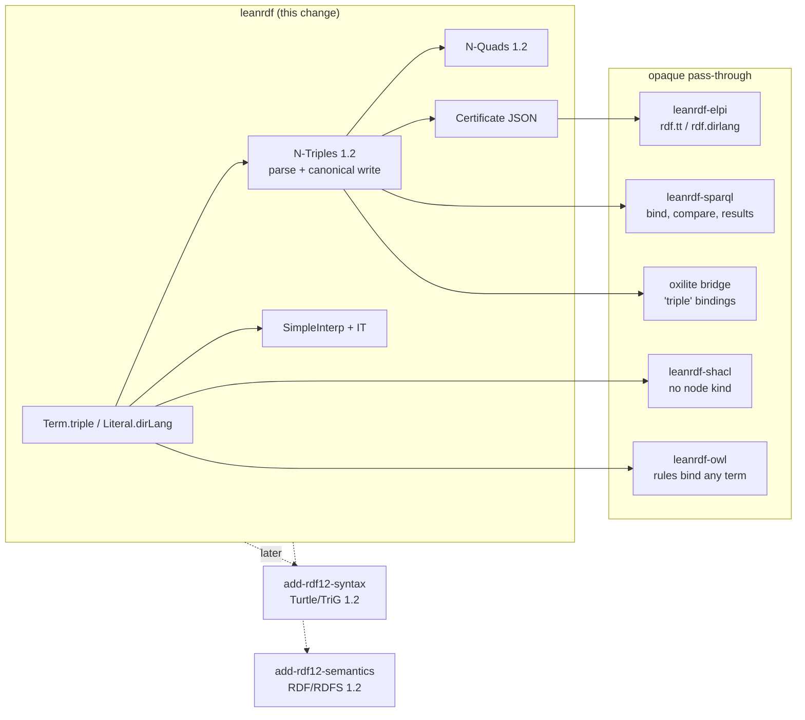

## Context

RDF 1.2 Concepts (CR, 7 April 2026) adds triple terms as RDF terms and base direction to language-tagged strings. RDF 1.2 Semantics (CRD, 24 September 2026) adds an injective `IT : IR × IP × IR → IR` to simple interpretations. RDF 1.2 N-Triples (WD, 23 October 2026) adds `tripleTerm`, `LANG_DIR` and `VERSION`. The W3C suites are in `w3c/rdf-tests` under `rdf/rdf12/`, and they include the RDF 1.1 suites through `mf:include`.

LeanRDF's `Term` is `iri | bnode | lit` over a two-constructor `Literal`. About 34 files in five packages match on these constructors exhaustively. The design interview of 2026-10-31 fixed the shape:

- one RDF 1.2 model everywhere, with a `Basic` predicate;
- `Term.triple s p o`;
- `Literal.dirLang`;
- opaque pass-through in the downstream packages;
- four sequential changes.

See proposal.md for the why.

## Goals / Non-Goals

**Goals:**
- Every existing theorem keeps its statement, and the RDF 1.2 data model joins it.
- Every package accepts RDF 1.2 data without crashing or silently mis-handling it.
- N-Triples and N-Quads 1.2 are conformant on the W3C suites, including canonicalization.

**Non-Goals:**
- Turtle and TriG 1.2 ([[changes#add-rdf12-syntax]]).
- The RDF and RDFS layers of RDF 1.2 Semantics: `rdf:dirLangString` recognized, `rdfs:Proposition`, rdfs14 ([[changes#add-rdf12-semantics]]).
- SPARQL 1.2 syntax and functions.
- SHACL 1.2.
- A lenient RDF 1.1-only parser mode.

## Decisions

### Triple terms are a recursive Term constructor

```lean
inductive Term where
  | iri (i : IRI) | bnode (b : BlankNode) | lit (l : Literal)
  | triple (s p o : Term)
  deriving DecidableEq, Hashable, Ord, Repr, Inhabited
```

`Triple` stays a structure over `Term`; `Term.triple` carries three terms rather than a `Triple`, so the two types are not mutually inductive and `deriving` keeps working. `Triple.toTerm` and `Term.asTriple?` convert between them.

Rejected:
- `triple (t : Triple)`: mutual induction in every proof, and hand-written `Hashable`/`Ord`.
- A separate `Term12` with an embedding: two models, with entailment, certificates and parsers each needed twice.
- `Term α` over a leaf type: every signature in five packages changes.

- motivated_by:: [[constraints#RDF 1.2 triples and triple terms]] {weight: primary}
- supersedes:: [[decisions#Generalized triples inside]] {reason: "Triple stays generalized, WellFormed becomes recursive"}

### Strict well-formedness is recursive; Triple stays generalized

`Triple` stays generalized: any term in any position, now including triple terms anywhere, as in RDF 1.2 Concepts §7.2. `Triple.WellFormed` is decided by structural recursion on the object:

- the subject is an IRI or a blank node;
- the predicate is an IRI;
- the object is an IRI, a blank node, a literal, or `.triple s p o` with `⟨s, p, o⟩.WellFormed`.

Parsers build only well-formed triples. Derivations, the Elpi closure and certificates may hold generalized ones; the RDF 1.2 rule rdfs14 will need them. `Basic` is the separate "no triple term anywhere" predicate, so a well-formed Basic triple is an RDF 1.1 triple, apart from directional literals.

- motivated_by:: [[constraints#Entailment rules use generalized RDF]] {weight: primary}
- motivated_by:: [[constraints#RDF 1.2 conformance levels]]

### Directional literals are a third Literal constructor

`Literal` becomes `typed lex dt | lang lex tag | dirLang lex tag (dir : Direction)`, with `Direction := ltr | rtl`. Each constructor maps to exactly one datatype: the given IRI, `rdf:langString` or `rdf:dirLangString`. `Literal.mk?` also rejects `typed _ rdf:dirLangString`, and every smart constructor lowercases tags (RDF 1.2 compares tags case-insensitively). Value-level code (`Literal.value?`, SPARQL `LANG`, SHACL `languageIn`) treats `dirLang` like `lang` for the tag.

Rejected:
- `lang lex tag (dir : Option Direction)`: every existing `.lang l t` pattern changes arity, and the langString/dirLangString split hides in an option.
- Rejecting `--ltr` as unsupported: the W3C 1.2 suites use it.

- motivated_by:: [[constraints#Directional language-tagged strings]] {weight: primary}
- supersedes:: [[decisions#Literals are typed or language-tagged]]

### IT is part of SimpleInterp from the first change

`denote` must be total over the new `Term`, so the simple-interpretation layer moves to RDF 1.2 here rather than in add-rdf12-semantics:

```lean
IT : Dom → Dom → Dom → Dom
IT_inj : IR x → IP y → IR z → IR x' → IP y' → IR z' → IT x y z = IT x' y' z' → x = x' ∧ y = y' ∧ z = z'
IT_IR  : IR x → IP y → IR z → IR (IT x y z)
-- a referent only on IT's domain (§5: IT is defined on IR × IP × IR); decided classically
denote A (.triple s p o) =
  match denote A s, denote A p, denote A o with
  | some x, some y, some z => if IR x ∧ IP y ∧ IR z then some (IT x y z) else none
  | _, _, _ => none
```

`Holds` of a triple whose object is a triple term with a non-denoting component, or with a component outside `IT`'s domain, is false, as for a literal outside `IL`. The domain test makes `denote` noncomputable (`Classical.propDecidable`), which [[decisions#Axiom-clean library]] allows. Without it, add-rdf12-semantics could not prove rdfs14 sound: a triple term whose predicate does not denote a property would denote `IT` outside the domain on which the RDFS proposition condition speaks. `IL` on `dirLang` literals is left unconstrained until add-rdf12-semantics recognizes `rdf:dirLangString`. That is a larger class of interpretations, so soundness only gets stronger. Every rule-soundness proof gains a case for terms that are triple terms. Their statements do not change, because rules bind triple terms like any other term.

Rejected: `denote (.triple …) = none` until add-rdf12-semantics. Every graph with a triple term would then be unsatisfiable, and so would entail everything: a wrong semantics, even for one change.

- motivated_by:: [[constraints#Triple-term denotation]] {weight: primary}
- amends:: [[decisions#Single-carrier interpretations]] {note: "adds IT on the single carrier"}

### Small models become free triple-term extensions

An injective `IT : IR × IP × IR → IR` has no finite model once `IR` has two elements. The finite carriers of the vacuity models therefore go through a free extension:

```lean
inductive Free (D : Type) where
  | base (d : D) | tt (x y z : Free D)
```

`IR` is `base` on the old `IR` plus every `tt` whose components qualify, and `IT = tt`, which is injective by constructor injectivity. `IEXT` is the old relation on `base` and empty on `tt`, so every existing countermodel survives unchanged. The same construction gives the countermodel for "a triple term is not asserted".

- motivated_by:: [[constraints#Triple-term denotation]] {weight: primary}
- amends:: [[decisions#Small-model family for vacuity]] {note: "carriers become Free D"}

### N-Triples and N-Quads 1.2 move with the core

Certificates, the oxilite bridge, the SPARQL result writers and every test fixture exchange terms as N-Triples (see [[decisions#Canonical N-Triples output]]). Opaque pass-through therefore needs the 1.2 term syntax in this change.

The recursive-descent parser gains three things:

- `tripleTerm` in object position, recursing into subject, predicate and object;
- `LANG_DIR`, where a `--` suffix gives `dirLang` and anything other than `ltr`/`rtl` is an error;
- `versionDirective` as a statement: case-sensitive `VERSION`, recorded but not acted on.

The serializer writes canonical 1.2: lowercase `LANG_DIR`, a single space after `<<(` and after each triple-term component, and no `VERSION`. A Basic graph without directional literals serializes byte-identically to before, so the RDF 1.1 round-trip tests run unchanged.



- motivated_by:: [[constraints#RDF 1.2 N-Triples grammar]] {weight: primary}
- motivated_by:: [[constraints#RDF 1.2 N-Quads grammar]]
- amends:: [[decisions#Canonical N-Triples output]] {note: "canonical 1.2 forms"}
- amends:: [[decisions#Recursive-descent N-Triples parser]] {note: "tripleTerm, LANG_DIR, VERSION"}

### Opaque pass-through downstream

Every package accepts triple terms with the least behaviour the specs define, and adds no RDF 1.2 features:

| Package | Triple term | Directional literal |
|---|---|---|
| elpi | `rdf.tt S P O`, recursive | `rdf.dirlang Lex Tag Dir` |
| certificates | N-Triples 1.2 text | N-Triples 1.2 text |
| sparql | binds, `sameTerm`/`=` by equality, `isIRI`/`isBlank`/`isLiteral`/`isNumeric` false, `STR`/`LANG`/`DATATYPE` error | `LANG` gives the tag, `DATATYPE` gives `rdf:dirLangString` |
| sparql results | JSON `triple`, XML `<triple>`, TSV/CSV `<<( … )>>` | JSON `its:dir`, XML `its:dir` |
| shacl | no node kind; literal-only components violated; `hasValue`, `in`, `equals`, `disjoint` by equality | a literal with its tag |
| owl | rules bind any term; no change in statements | — |
| oxilite bridge | reads `triple` bindings | reads `its:dir` |

Rejected:
- Rejecting non-Basic input at the package boundaries: users would hit a wall on 1.2 data, and the proofs gain nothing.
- A full SPARQL 1.2 upgrade now: deferred by the interview.

- motivated_by:: [[constraints#RDF 1.2 conformance levels]] {weight: primary}
- amends:: [[decisions#Hand-written Elpi term encoding]] {note: "rdf.tt and rdf.dirlang"}

## Constraints

- [[constraints#Simple interpretations]] and [[constraints#Entailment rules use generalized RDF]] still bind.
- RDF 1.2 versions replace [[constraints#Language tag iff langString]], [[constraints#N-Triples grammar]] and [[constraints#N-Quads grammar]].
- New:
  - `RDF 1.2 triples and triple terms` (RDF 1.2 Concepts §3.1, §3.6, §3.7)
  - `Directional language-tagged strings` (RDF 1.2 Concepts §3.4)
  - `RDF 1.2 conformance levels` (RDF 1.2 Concepts §2, §2.1)
  - `Triple-term denotation` (RDF 1.2 Semantics §5, §5.1)
  - `RDF 1.2 N-Triples grammar` (RDF 1.2 N-Triples §3, §5.3, §6)
  - `RDF 1.2 N-Quads grammar` (RDF 1.2 N-Quads)

## Risks / Trade-offs

- **[Risk] The constructor churn across about 34 files breaks a proof in a way that is hard to see.** → The change lands package by package (core, then elpi, sparql, shacl, owl), with `lake build` and `lake test` green after each, and a `#print axioms` check on the soundness theorems.
- **[Risk] Recursive `Term` slows `deriving Ord` or `Hashable`, or makes `decide` on large terms expensive.** → Measure the W3C suite run time before and after. Hand-write `Ord` if derived compare dominates.
- **[Risk] The 1.2 specs are CR and WD drafts and may still move** (N-Triples Example 6 writes `@en-ltr` where the grammar requires `--`). → Vendor the suites at a pinned commit, cite section numbers, and record any divergence as a Simplification.
- **[Risk] `its:dir` in SPARQL results JSON and XML follows the SPARQL 1.2 Query Results drafts.** → Check it against the current draft before implementing, and keep reading the 1.1 forms.
- **[Trade-off] `IL` on directional literals stays unconstrained until add-rdf12-semantics.** Sound, but weaker than RDF 1.2 for one change.

## Migration Plan

`Term` and `Literal` gain constructors, so downstream Lean users with exhaustive matches need new arms. The release notes of v0.2.0 (in add-rdf12-semantics) list this as the breaking change. No data migration is needed: RDF 1.1 documents parse to the same graphs, and Basic graphs serialize to the same bytes.
