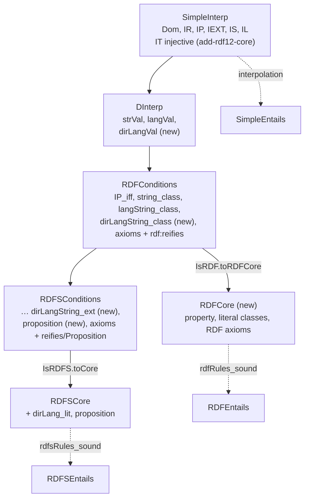
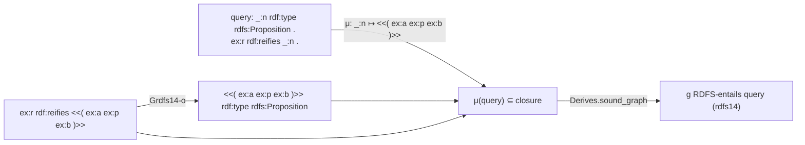
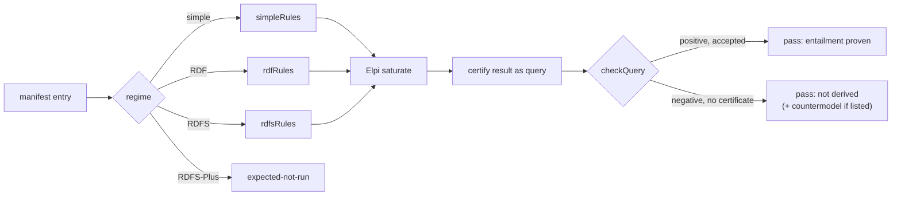

## Context

[[changes#add-rdf12-core]] gives `Term.triple`, `Literal.dirLang` and the vocabulary `rdf:reifies`, `rdf:dirLangString` and `rdfs:Proposition`. It also adds the injective `IT` to `SimpleInterp` (RDF 1.2 Semantics §5), with `denote (.triple s p o) = IT …`, and turns the vacuity models into free triple-term extensions. There, `IL` on directional literals is unconstrained. [[changes#add-rdf12-syntax]] gives Turtle and TriG 1.2, in which the W3C semantics tests are written.

What is left is RDF 1.2 Semantics §7 to §9:
- the third recognized datatype;
- `rdf:reifies` as a property, with its domain and range;
- the class `rdfs:Proposition` and its condition on `IT`;
- the patterns rdfs14 and rdfs14a (§9.2.1).

The spec states rdfs14 with a blank node that replaces the triple term. The rule format has no existential heads today; rdfD1 is handled the same way, through GrdfD1 and graph queries ([[decisions#Graph queries with instance mappings]]).

Status of the texts: Semantics is a Candidate Recommendation Draft (24 September 2026), and Concepts a CR Snapshot (7 April 2026). The W3C `rdf/rdf12/rdf-semantics` manifest has 29 active tests (positive and negative entailment tests, regimes `simple`, `RDF`, `RDFS` and `RDFS-Plus`). No RDF 1.1 semantics suite runs today.

## Goals / Non-Goals

**Goals:**
- the RDF and RDFS layers of RDF 1.2 Semantics, one field per condition;
- every new pattern proven sound;
- Elpi saturation and certificates covering them;
- the W3C RDF 1.2 semantics suite run honestly;
- v0.2.0.

**Non-Goals:**
- completeness of the rule set, including RDF 1.2 Semantics Appendix C (non-well-founded propositions);
- D-entailment for datatypes outside D, and `RDFS-Plus`;
- SPARQL 1.2;
- an opaque reading of triple terms (the spec makes them transparent).

## Decisions

### Three recognized datatypes with abstract values

`DInterp` gains `dirLangVal : String → String → Direction → Dom`, injective, with `IL_dirLang : IL (.dirLang s t d) = some (dirLangVal s t.toLower d)` (§7.1). `RDFConditions` gains `dirLangString_class` and `RDFSConditions` gains `dirLangString_ext`. `datatypes` and `datatypeAxioms` include `rdf:dirLangString`.

Rejected:
- Reusing `langVal` with a direction option, which would blur two value spaces that §7 keeps apart.
- Leaving `rdf:dirLangString` unrecognized, which §8 forbids ("MUST be recognized").

- motivated_by:: `RDF 1.2 RDF interpretations` {weight: primary}
- amends:: [[decisions#Layered interpretations with a core]]

### Propositions are the image of IT on its domain

`RDFSConditions.proposition : ∀ x y z, IR x → IP y → IR z → InClass (IT x y z) (IS rdfs.Proposition)`. This transcribes the §9 condition one way, as the spec's table states it; the prose "exactly the set of propositions" is not made a condition. `RDFSCore.proposition` carries it.

Soundness of the `Grdfs14` rules needs a triple term that denotes to denote an element of that domain. In an RDF interpretation the subject and object components are in `IR`, because `IP ⊆ IR` by `RDFConditions.IP_IR`. The predicate component is in `IP` only if `denote` gives a triple term a referent only when its predicate denotes a property, as `IT`'s domain `IR × IP × IR` in §5 demands. add-rdf12-core gives `denote` exactly that domain check, under the constraint `Triple-term denotation`.

Rejected:
- Quantifying over the whole image of `IT`. That narrows the class of interpretations, so the entailment relation would be stronger than the spec's and soundness would no longer imply the spec's soundness.

- motivated_by:: `RDF 1.2 RDFS conditions` {weight: primary}
- motivated_by:: `Triple-term denotation` {weight: primary}
- amends:: [[decisions#Readings of the condition tables]]

### Triple-term patterns in rules

`Pat` gains `triple (s p o : Pat)`. `Pat.apply` builds the triple term, `Pat.vars` collects its variables, and `matchPat` matches only a `Term.triple` and recurses into it. The checker's single matching lemma (`match p t = some σ → σ.apply p = t`) extends by induction on the pattern. Codegen writes the pattern as an Elpi triple-term term with variables, so Elpi unification does the matching.

Rejected:
- A guard `tripleTerm v` without destructuring. A rule could then not name the components of a triple term, so the nested rules and the ground `rdfs14a` head could not be written.
- A special rule kind for rdfs14. The checker, Codegen and the certificate format would each grow a second path.

- motivated_by:: [[constraints#Entailment rules use generalized RDF]] {weight: primary}
- amends:: [[decisions#Horn rules matched by the checker]]
- amends:: [[decisions#Rules generated from Lean]]

### rdfs14 as generalized Horn rules plus graph queries

rdfs14 is "replace the triple term by `_:nnn`, add `_:nnn rdf:type rdfs:Proposition`". It is stated as generalized rules whose head types the triple term itself, mirroring GrdfD1 for rdfD1:
- `Grdfs14-s`, `Grdfs14-p`, `Grdfs14-o` type a triple term at the top level of a derived triple;
- `Grdfs14-in-s`, `Grdfs14-in-p`, `Grdfs14-in-o` type a triple term inside a triple term already typed `rdfs:Proposition`;
- `rdfs14a` is a premise-free rule with the ground head `<<( rdf:type rdf:type rdf:Property )>> rdf:type rdfs:Proposition`.

The rules' own triples are true in every RDFS interpretation. The spec's blank-node forms then follow by the instance-mapping lemma: the query `_:n rdf:type rdfs:Proposition . x p _:n` is certified with `_:n ↦ <<(…)>>`.

The heads only reuse subterms of the body, so saturation creates no new terms, and the closure stays finite: it holds the subterms of the input, the axioms and one witness.

Rejected:
- Rules with existential heads, which need a fresh-node operator in Elpi and in the checker.
- A Simplification that leaves rdfs14 out, because the W3C tests `triple-terms-propositions` and `reifies-range` need it.

- motivated_by:: `RDF 1.2 entailment patterns` {weight: primary}
- motivated_by:: [[constraints#Entailed blank nodes are existential]]
- amends:: [[decisions#Graph queries with instance mappings]]

### Regime rule sets for simple and RDF entailment

`simpleRules := []`. `Derives.sound_graph_simple` follows from the interpolation lemma, because a derivation from no rules is membership. `rdfRules` holds rdfD2, GrdfD1 for D, the RDF axioms and the `rdf:_n rdf:type rdf:Property` rule. It is proven sound against a new `RDFCore`, which is derived from `IsRDF`. Certificates take the regime's rule list, and `checkQuery_sound_rdf` and `checkQuery_sound_simple` are corollaries of the existing checker lemma.

Rejected:
- Certifying `simple` and `RDF` tests with `rdfsRules`. That proves RDFS entailment, which is weaker than the claim of a simple or RDF positive test.

- motivated_by:: `RDF 1.2 semantics test suite` {weight: primary}
- amends:: [[decisions#Layered interpretations with a core]]

### The W3C semantics suite in the bridge package

The runner lives in `elpi/BridgeTests/Rdf12Semantics.lean`, because saturation needs Elpi. For each manifest entry it:
1. parses the action and result with Turtle 1.2;
2. picks the rule list by `mf:entailmentRegime`;
3. saturates;
4. certifies the result graph as a query, its blank nodes existential;
5. checks the certificate.

A positive test passes on an accepted certificate. A negative test passes when the result is not derived, and it is reported as "not derived" ([[decisions#Demo never claims non-entailment]]). Negative tests about triple terms (`triple-term-not-asserted` at least) also get kernel countermodels in `Tests/Semantics/Vacuity.lean`. An expected-not-run file lists `RDFS-Plus` tests and tests that need datatypes outside D, each tied to a simplification.

- motivated_by:: `RDF 1.2 semantics test suite` {weight: primary}
- motivated_by:: [[decisions#Elpi finds, Lean checks]]

### Vacuity with propositions

The small-model family (now free triple-term extensions) makes `rdfs:Proposition` a universal class, so the proposition condition holds trivially. It treats `rdf:dirLangString` like `rdf:langString`: its extension is exactly the directional values. New kernel facts:
- a model of a graph with a reifier;
- the countermodel for "a triple term is not asserted";
- hand proofs of rdfs14 and of the `rdf:reifies` axioms.

- amends:: [[decisions#Small-model family for vacuity]]
- amends:: [[decisions#Semantics tested against vacuity]]

## Constraints

- [[constraints#RDFS interpretation conditions]] binds the new RDFS fields, and its source moves to RDF 1.2 Semantics §9.
- [[constraints#Entailment rules use generalized RDF]] binds the `Grdfs14` rules, whose heads have triple-term subjects.
- [[constraints#Entailed blank nodes are existential]] binds the query form of rdfs14 and rdfs14a.
- [[constraints#RDF interpretations recognize two datatypes]] is replaced by `RDF 1.2 RDF interpretations`.
- `Triple-term denotation` (from add-rdf12-core, RDF 1.2 Semantics §5): a triple term denotes `IT` of its components, and `IT` is defined on `IR × IP × IR`. It binds "Propositions are the image of IT on its domain".
- New: `RDF 1.2 RDF interpretations` (RDF 1.2 Semantics §7.1, §8). D-interpretations recognize `rdf:langString`, `rdf:dirLangString` and `xsd:string`, a directional literal denotes `⟨sss, ttt', bbb⟩`, and the RDF axioms include `rdf:reifies rdf:type rdf:Property`.
- New: `RDF 1.2 RDFS conditions` (RDF 1.2 Semantics §9). These are `ICEXT(I(rdf:dirLangString))`, every `IT(x, y, z)` being in `ICEXT(I(rdfs:Proposition))`, and the axioms `rdf:reifies rdfs:domain rdfs:Resource`, `rdf:reifies rdfs:range rdfs:Proposition` and `rdfs:Proposition rdfs:subClassOf rdfs:Resource`.
- New: `RDF 1.2 entailment patterns` (RDF 1.2 Semantics §8.1.1, §9.2.1): rdfD1, rdfD1a, rdfD2, and rdfs14 and rdfs14a with existential blank nodes.
- New: `RDF 1.2 semantics test suite` (w3c/rdf-tests `rdf/rdf12/rdf-semantics`, 29 tests, W3C Test Suite and 3-clause BSD licences): positive and negative entailment tests in four regimes.
- Amended Simplification [[simplifications#Two recognized datatypes with abstract values]] becomes `Three recognized datatypes with abstract values`, with `dirLangVal` beside `strVal` and `langVal`.
- New Simplification `Datatype rules see asserted positions only` (RDF 1.2 Semantics §8.1.1). GrdfD1 matches a literal only as a top-level term of a triple, not inside a triple term. Soundness is unaffected; impact incompleteness, and it deviates from `RDF 1.2 entailment patterns`.

## Risks / Trade-offs

- [`Grdfs14` soundness depends on `denote` giving triple terms referents only on `IT`'s domain] → add-rdf12-core specifies exactly that (scenario `A triple term outside the domain of IT has no referent`), and task 0.1 re-checks it before work starts.
- [Semantics is a CR Draft, and axiom or pattern lists may change] → rule and axiom counts are pinned in one scenario, and the manifest commit is pinned when vendored.
- [The W3C semantics tests may need value reasoning (e.g. `opaque-literal` with `xsd:integer`)] → they go to the expected-not-run file under the datatype simplification, not into silent failures.
- [Negative tests prove only "not derived"] → stated in the report. Kernel countermodels cover the triple-term-specific ones.
- [Six `Grdfs14` variants are many rules] → each is one line plus a short soundness case, and generalized RDF needs all three positions.

## Migration Plan

`rdfsRules` grows, so certificates from v0.1 stay valid: rule names are unchanged, and a certificate may name any rule of the list. `DInterp` and the condition structures gain fields, so code that builds interpretations (the test models) must provide them. The v0.2.0 release notes list this as a breaking change of the Lean API.
