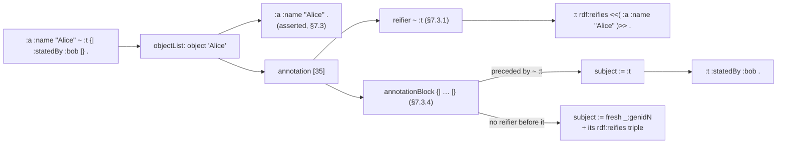
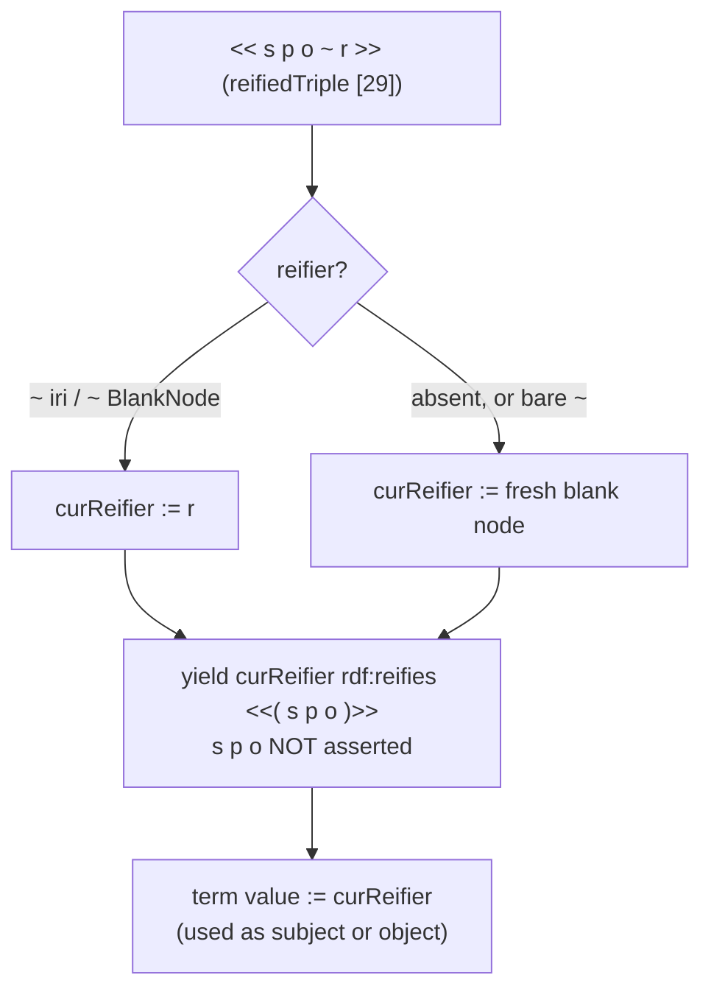

## Context

`LeanRDF/Parse/Turtle/Parser.lean` is one recursive-descent parser for Turtle and TriG (606 lines). Its state `St` holds the position, base, prefixes, a fresh-node counter, the current graph and the quads emitted so far. `object` returns a term and emits nested triples; `objectList s p` emits `s p o` per object; `renameFresh` renames generated nodes (NUL-prefixed labels) to `genidN` after parsing. TriG reuses the same statement parser ([[decisions#TriG on the Turtle statement parser]]).

After `add-rdf12-core`, `Term` has `triple s p o`, `Literal` has `dirLang`, `Triple.WellFormed` is the strict RDF 1.2 condition and N-Triples/N-Quads 1.2 parse `<<( … )>>` and `LANG_DIR`. Turtle and TriG reject all three. There is no Turtle writer in the core package.

Sources: RDF 1.2 Turtle, W3C Working Draft 23 October 2026, §2.4 (version), §2.10 (triple terms), §2.11 (reifying triples, annotation syntax), §6.5 (grammar) and §7.2–§7.3 (term constructors, triple-producing rules). RDF 1.2 TriG, W3C Working Draft 7 October 2026, §5 and §6.

## Goals / Non-Goals

**Goals:** the whole RDF 1.2 Turtle and TriG grammars; reification desugared exactly by §7.3; RDF 1.1 documents unchanged; all W3C RDF 1.1 and RDF 1.2 Turtle and TriG tests passing.

**Non-Goals:** a Turtle or TriG writer (output stays N-Triples/N-Quads); reading the version label as a mode switch; RDF/XML 1.2; SPARQL 1.2 syntax.

## Decisions

### Reification as sugar in the statement parser

Reified triples and annotations are expanded while parsing, into `rdf:reifies` triples in the current graph; no reified-triple node exists in any data structure.

`reifiedTriple` is a new alternative of `object` and of `triples`' subject: it parses `rtSubject verb rtObject reifier?`, emits the reifying triple and returns the reifier term, so nesting (`<< << … ~ :r1 >> :q :d >>`) needs no extra code. `objectList` parses an `annotation` after each object, holding the reifier last read (the spec's `curReifier`) in a local, not in `St`, and clearing it after each block.

Rejected: an intermediate syntax tree desugared in a second pass (a second copy of the grammar's shape, and §7.3 is already written as a one-pass rule set); keeping reifiers as a separate output (the spec's result is an RDF graph, and statement graphs read `rdf:reifies` from the graph).

- motivated_by:: [[constraints#Turtle 1.2 reification mapping]] {weight: primary}
- motivated_by:: [[decisions#TriG on the Turtle statement parser]] {weight: secondary}

### Triple terms parsed by restricted productions

`tripleTerm` is its own production with `ttSubject` (IRI or blank node, `[]` allowed) and `ttObject` (IRI, blank node, literal, triple term), not a call to `object`. Collections, property lists and reified triples inside a triple term are therefore syntax errors without a separate check, and every triple term built is well-formed by the strict RDF 1.2 condition of `add-rdf12-core`. `<<(` is matched as one token before `<<` and before `<` (IRIREF), so `<< (` is a reified triple whose subject `(` is rejected.

Rejected: parsing with `object` and checking `WellFormed` afterwards (worse error positions, and `object` emits triples for collections that would then have to be withdrawn).

- motivated_by:: [[constraints#Turtle 1.2 grammar]] {weight: primary}

### Version announcements are hints

`@version "…" .` and `VERSION "…"` are directives whose label is read and discarded. A `1.2-basic` document containing triple terms still parses. This follows the decision of `add-rdf12-core` that LeanRDF reads RDF 1.2 everywhere and uses a `Basic` predicate, not parser modes.

Rejected: rejecting triple terms after `VERSION "1.2-basic"` (§2.4 calls the label a hint, and a mode would break the "one parser" decision); rejecting unknown labels (no rule asks for it). If a W3C negative test requires otherwise, the test wins and the decision is amended.

- motivated_by:: [[constraints#Turtle 1.2 grammar]] {weight: primary}

### Generated reifiers share the genid scheme

Fresh reifiers come from the existing `freshNode` (NUL-prefixed labels) and are renamed by `renameFresh` with every other generated node. `renameFresh` and the label scan that collects document labels recurse into triple terms, so a `_:genid1` inside `<<( … )>>` is avoided and a generated node inside a triple term is renamed.

Rejected: a second counter or a `reifierN` prefix (two schemes to keep collision-free, and evaluation tests compare up to isomorphism anyway).

- motivated_by:: [[decisions#TriG on the Turtle statement parser]] {weight: secondary}

### RDF 1.2 suites beside the RDF 1.1 suites

`rdf/rdf12/rdf-turtle` and `rdf/rdf12/rdf-trig` are vendored at one pinned `w3c/rdf-tests` commit into `Tests/data/rdf12-turtle/` and `Tests/data/rdf12-trig/` (their `syntax` and `eval` sub-manifests), with licence and README. Their `mf:include` of `../../rdf11/…` is not followed: the RDF 1.1 suites stay where they are, at their own commit, and keep their own requirements. `scripts/w3c-index.py` learns sub-manifests (one `index.txt` per directory) and any new `rdft:` test types. The test isomorphism (`Tests/Turtle/Iso.lean`, `Tests/Datasets/Iso.lean`) maps blank nodes inside triple terms.

Rejected: replacing the 1.1 copies with the 1.2 tree (it would move every existing path and count at once, and the 1.1 requirements cite them).

## Constraints

- [[constraints#Turtle grammar]] and [[constraints#TriG grammar]] (RDF 1.1) still bind: every 1.1 document parses as before.
- [[constraints#RFC 3986 reference resolution]] binds IRIs inside triple terms and reifiers.
- New: `Turtle 1.2 grammar` (RDF 1.2 Turtle §6.5, productions [3], [6], [9]–[11], [13], [17], [22], [28]–[36], [42]; keyword case rules of §6.5; §2.4 version announcement as a hint) — constrains `Triple terms parsed by restricted productions`, `Version announcements are hints`.
- New: `Turtle 1.2 reification mapping` (RDF 1.2 Turtle §2.11, §2.11.1, §7.2, §7.3.1–§7.3.4: one `rdf:reifies` triple per reifier, fresh blank node without one, base triple asserted only by annotations) — constrains `Reification as sugar in the statement parser`.
- New: `TriG 1.2 grammar` (RDF 1.2 TriG §5, §6: Turtle 1.2 statements in graph blocks, directives only outside blocks) — constrains [[decisions#TriG on the Turtle statement parser]].

## Risks / Trade-offs

- [The Turtle and TriG 1.2 drafts can still change before Recommendation] → pin the `w3c/rdf-tests` commit and the draft dates in the README and the constraints; a later draft is a new change.
- [Refactoring `object`, `objectList` and `triples` risks 1.1 regressions] → the 313 RDF 1.1 Turtle tests and the TriG 1.1 suite run unchanged on every `lake test`.
- [`<<` vs `<<(` vs `<` lexing] → ordered lookahead (`<<(`, then `<<`, then IRIREF) with negative tests from the suite and the scenarios.
- [A W3C test may disagree with a scenario here, e.g. on version labels] → the suite prevails; the scenario and the decision are amended in this change.
- [Generated-node numbering changes for 1.1 documents] → none: reifiers are generated only by 1.2 syntax, and the scan over triple terms adds no labels to 1.1 documents.

## Migration Plan

Additive: `Turtle.parse`, `TriG.parse` and `parseTriples` keep their signatures. Documents without 1.2 syntax give identical results. Rollback is reverting the change.
