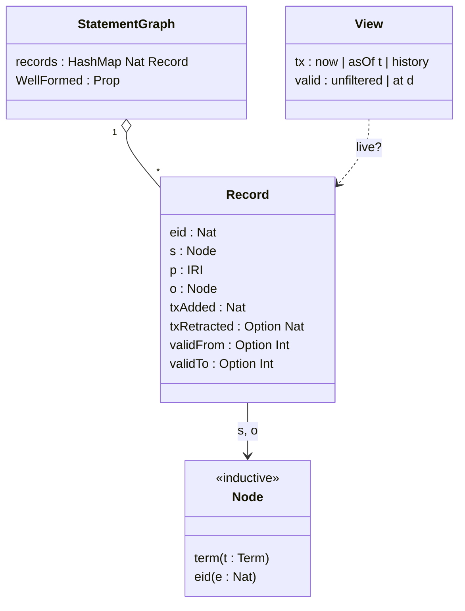
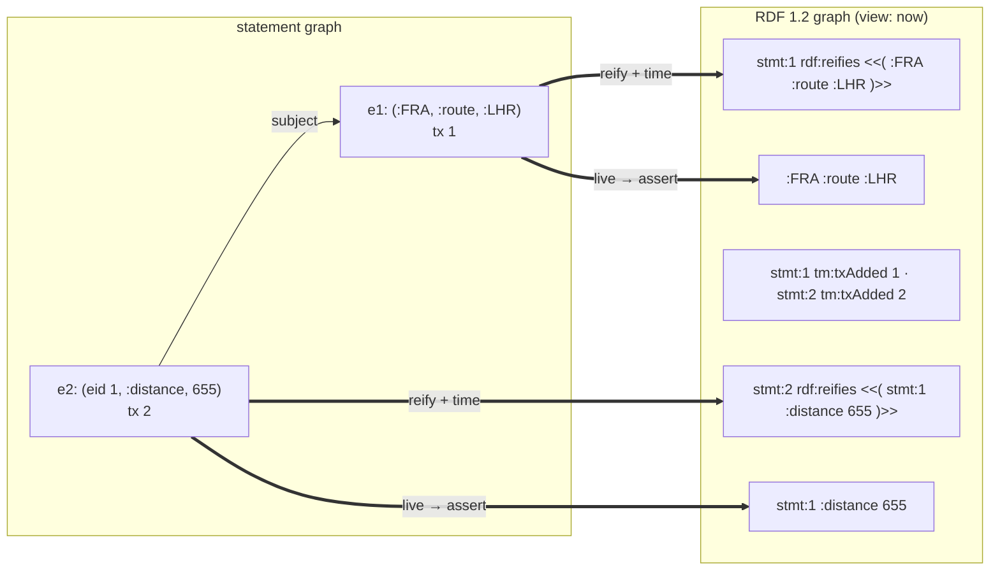
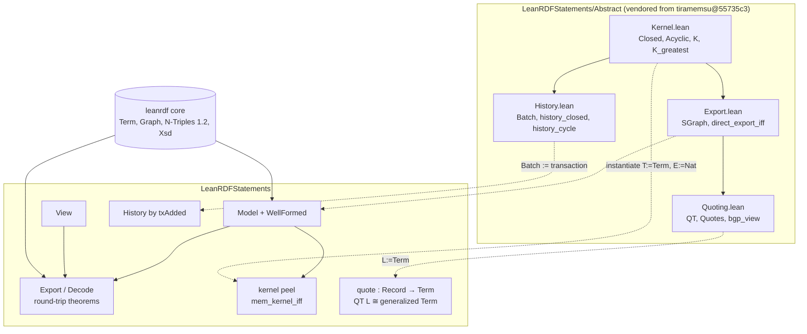
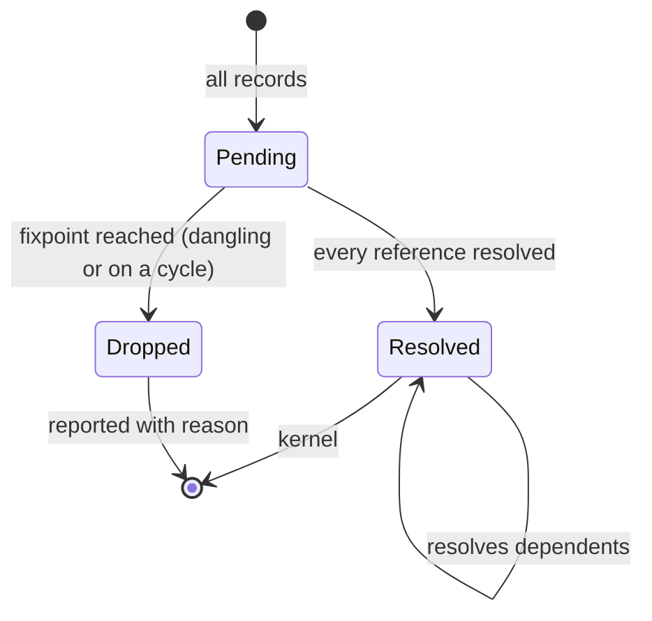

## Context

The four sources this change works from:

- **tiramemsu** (`../tiramemsu`, tiramemsu.com) stores statements as rows `(eid, s, p, o, tAdd, tRet?, vFrom?, vTo?)`. The subject and object can be another row's eid. Rows are never deleted, and only self-reference is forbidden, so snapshots can dangle and correction replays can form longer cycles. Its SPARQL surface uses RDF 1.2 reification with `tm:txAdded`, `tm:txRetracted`, `tm:validFrom` and `tm:validTo` (`tm:` = `urn:tiramemsu:tm:`), and statement IRIs `urn:tiramemsu:stmt:N`.
- **The paper** (rev. 4, 12 October 2026, Zenodo 10.5281/zenodo.23335652) proves, in core-only Lean over abstract `T`, `E` and `L` types:
  - an identity-preserving export to a Gelling–Fletcher–Schmidt Statement Graph exists iff the record set is closed and acyclic (`direct_export_iff`);
  - the greatest closed acyclic subset `K` exists (`K_greatest`);
  - the full history is closed, and cycles stay inside one replay batch (`history_closed`, `history_cycle`, `history_kernel`);
  - a quoting map into RDF-star values preserves BGP answers (`quotes_*`, `bgp_view`).

  The source is `paper/statement-as-one-record/lean` at commit `55735c3`, about 1.4k lines, on Lean v4.34.1.
- **The GFS Statement Graph** is a DAG. Each internal vertex is a statement with exactly three role edges (subject, predicate, object). The subject and object may point at another statement; the predicate may not.
- **RDF 1.2** (after [[changes#add-rdf12-core]]) puts triple terms only in object position, and the subject of a triple term must be an IRI or a blank node. Nested quoting in subject position, which the paper's `QT` uses, is therefore generalized RDF 1.2, not strict.

The design interview of 2026-10-31 settled the open choices:

- the model is bitemporal;
- `asserted` is derived from a view;
- the reifier encoding is primary and quoting is secondary;
- the decoder is exact;
- a `WellFormed` predicate reserves the export's names;
- tiramemsu's sets are admitted;
- the paper's proofs are vendored;
- the code is a new package;
- LeanRDF is the reference for the format.

## Goals / Non-Goals

**Goals:**
- One statement-graph type that holds tiramemsu's states: snapshots, histories, and replays with cycles.
- A strict RDF 1.2 export with a two-way exact round trip.
- The paper's theorems on LeanRDF types, plus executable checks proven equal to them.

**Non-Goals:**
- Importing arbitrary RDF 1.2: blank-node reifiers, missing times, unreified triples.
- Certifying tiramemsu's live database.
- The acyclic-replay write rule.
- Cost bounds and the property-graph image.
- Turtle 1.2 output, unless the core gains a Turtle writer.
- SPARQL over statement graphs.

## Decisions

### Bitemporal records with eid references

`Node` and the record content match the paper's `Node T E` and `Content T E`, so instantiating the vendored theorems is a direct substitution. Transaction time is a `Nat`, because only its order matters to the history theorems. Valid time is `Int` epoch milliseconds, matching tiramemsu's storage, and is exported as an `xsd:integer`. Time, provenance and confidence other than the four clocks are just more records whose subject is an eid.

Rejected:
- An atemporal model, with time as ordinary statements: the history theorems and the `tm:` export would then live outside LeanRDF.
- A generic `meta : M` parameter on every theorem.

- motivated_by:: [[constraints#tiramemsu record model]] {weight: primary}
- motivated_by:: [[concepts#Statement record]]

### Assertion is derived from a view

A record has no stored `asserted` flag. `live v r` follows tiramemsu's `TxSel` and `ValidSel`:

- `now` means not retracted;
- `asOf t` means `txAdded ≤ t ∧ ¬(txRetracted ≤ t)`;
- `history` means always;
- the valid-time point is checked against a half-open interval.

The export asserts exactly the live records. This replaces the interview's first answer (a per-statement flag): with two clocks, a stored flag could disagree with them, and tiramemsu has no such state.

- motivated_by:: [[constraints#tiramemsu record model]] {weight: primary}
- motivated_by:: [[concepts#View]]

### Reifier export is primary

Each record becomes the following, with eid references replaced by statement IRIs:

- one reifying triple, `stmt:e rdf:reifies <<( s' p o' )>>`;
- one to four time triples;
- the base triple, when the record is live.

References are names, so the export needs neither closure nor acyclicity: dangling references and cycles are just IRIs. It is strict RDF 1.2 for every well-formed graph. Two records with the same content give two reifiers of one triple term. The base triple is asserted once, as RDF set semantics requires, and the reifiers keep the occurrences apart. In Turtle 1.2 the example reads `<< << :FRA :route :LHR ~ stmt:1 >> :distance 655 ~ stmt:2 >>`, because reified triples nest by name.

Rejected:
- Quoting as the primary export: nested triple terms in subject position are not strict RDF 1.2.
- Reifiers only, without the quoting view: that loses the link to the paper's Statement Graph theorems.

- motivated_by:: [[constraints#RDF 1.2 triples and triple terms]] {weight: primary}
- motivated_by:: [[concepts#Reifier]]

### Exact decoder and the reserved names

`decode v g` reads every `stmt:N` subject as a record:

- its one `rdf:reifies` object gives the content;
- the `tm:` triples give the clocks;
- every other triple must be the base triple of a record live in `v`, and the base triple of every live record must be present.

Both round-trip directions are theorems. Exactness needs the export's own names kept out of user content. Without that, a user term `<urn:tiramemsu:stmt:5>` would read as a reference to eid 5, and a record `(eid 1, tm:txAdded, 7)` would collide with eid 1's clock. `WellFormed` therefore forbids `stmt:` IRIs anywhere in content, including inside triple terms, and forbids `rdf:reifies` and the four time predicates as record predicates. tiramemsu enforces the same at write time for its `sys:` and `tm:` namespaces.

Rejected:
- Time triples in a named graph: that changes the target to a `Dataset` and still needs the `stmt:` rule.
- Escaping clashing IRIs: it needs its own injectivity proof and diverges from tiramemsu's IRIs.
- A lenient import as the decoder: a later, separate function.

- motivated_by:: [[constraints#tiramemsu record model]] {weight: primary}

### Vendored abstract proofs, concrete layer on top

The abstract files are copied with a header giving the paper's DOI, the source commit and the licence. The code is under the tiramemsu repository's `MIT OR Apache-2.0`, the same as LeanRDF's; the paper text is CC BY 4.0. They are ported to Lean 4.35 and kept abstract. The concrete layer instantiates them:

- `T := Term` and `E := Nat` for records;
- `L := Term` for the quoting view, with `QT Term` mapped into `Term.triple`;
- a history's batches are its transactions grouped by `txAdded`, each a replay batch, since same-transaction references are allowed.

Rejected:
- A Lake git dependency on the tiramemsu subdirectory: toolchain coupling, and it bends [[decisions#Dependency-free core package]] for this package.
- Re-proving the results concretely: duplicated work, and the paper's theorem names are lost.
- A shared third repository: one more thing to maintain.

- motivated_by:: [[constraints#Statement Graph definition]] {weight: primary}
- motivated_by:: [[constraints#Lean toolchain 4.35]]

### Clocks are integer literals

All four clocks are exported as `xsd:integer` literals: transaction numbers as they are, valid times as epoch milliseconds. The interview chose `xsd:dateTime` for valid time. Implementation showed that the exact decoder then needs a proven round trip between epoch milliseconds and the proleptic Gregorian calendar (Hinnant's civil-from-days inverse), which `omega` cannot prove directly and which a case analysis made slow and still incomplete. With integer literals, the round trip is `parseInteger_canonical`, already proven in the core.

Rejected: `xsd:dateTime` with the calendar proven (open-ended proof work), and `xsd:dateTime` with the codec only tested (the decoder theorems would rest on an unproven lemma). Readers that want dates convert the milliseconds; tiramemsu's own SPARQL views still show dates.

- motivated_by:: [[constraints#tiramemsu record model]]

### Executable kernel proven against K

`kernel` is a peel from below: starting from no records, it adds the records all of whose references are already in, and repeats, at most once per record. It is quadratic, not the paper's linear-time Kahn peel; the cost bound is not mechanized either way. `mem_kernel_iff : e ∈ kernel sg ↔ K (crefs c) S e` links it to the vendored `K`, and `isClosed` and `isAcyclic` are decided by the same machinery.

- motivated_by:: [[constraints#Statement Graph definition]]
- motivated_by:: [[concepts#Export kernel]]

### A separate package with a CLI

`statements/` is `leanrdf-statements`, requiring only the core by path, in the style of [[decisions#Layers as packages in one repository]]. It has:

- the library `LeanRDFStatements`;
- the tests `StatementsTests`, whose test driver runs the exhaustive check as compiled code;
- `lean_exe leanrdf-sg`.

The core gains nothing: the clocks are integer literals (see *Clocks are integer literals*). The `tm:` and `stmt:` IRIs live in the package, never in `LeanRDF.Vocab`.

JSON lines is the input format, because tiramemsu's rows map to it one to one and the existing JSON reader in `LeanRDF/Cert/Json.lean` can be reused. Terms inside it use N-Triples 1.2 syntax, read with the core term parser.

- motivated_by:: [[decisions#Layers as packages in one repository]] {weight: primary}
- motivated_by:: [[decisions#Dependency-free core package]]

### LeanRDF's export is the reference format

`tm export` writes only live, flat statements today. LeanRDF's `export` is the definition with theorems, and tiramemsu later adds `tm export --format sg-nt12` to match it. Until then, the goldens are written by hand from the paper's examples and tiramemsu's test stores, and are tagged `pending tm cross-check`. A small script later regenerates them from `tm` and diffs the two.

- motivated_by:: [[decisions#LeanRDF is the proof layer for oxilite]] {note: "same role towards tiramemsu"}

## Constraints

- [[constraints#RDF 1.2 triples and triple terms]] binds the export (strict positions).
- [[constraints#Lean toolchain 4.35]] binds the vendored port, which needed no edit beyond imports.
- New:
  - `Statement Graph definition` (Gelling, Fletcher and Schmidt; arXiv 2304.13097, and DOI 10.1007/978-981-97-5575-2_27): a DAG of statement vertices with exactly three role edges, the predicate never a statement.
  - `tiramemsu record model` (tiramemsu `lean/Tiramemsu/Store/Types.lean`, tiramemsu.com *Statement Graphs* article): records, views, reserved namespaces, and only self-reference forbidden.

## Risks / Trade-offs

- **[Risk] Porting the paper's Lean from 4.34.1 to 4.35 breaks `simp` or `omega` calls.** → The port is the first task, and it is small (about 1.4k lines, core only). Keep a diff against the source commit in `Abstract/README.md`.
- **[Risk] The paper and LeanRDF drift apart.** → The vendored files carry the commit. A later CI job can diff them against tiramemsu.
- **[Risk] tiramemsu's `tm export` ends up choosing other literal datatypes or IRIs.** → LeanRDF is the reference by decision, so the spec is the contract the tiramemsu change follows.
- **[Risk] The exhaustive check is too slow at four records.** → Measure it first. The alphabet and interval set are parameters, and the run goes through the compiled test driver, not `#eval` at elaboration.
- **[Trade-off] Reserved names restrict user content.** That is acceptable: tiramemsu reserves the same namespaces, and annotations use other predicates.
- **[Trade-off] The quoting view is generalized RDF only.** It exists for the paper's theorems and for reproducing them, not for interchange.

## Migration Plan

This is a new package, so nothing migrates. v0.3.0 adds `leanrdf-statements` to CI and to the release, with a book chapter citing the paper, and adds `examples/statement-graphs/` (the supersede history exported in `history` and in `now`) to `scripts/examples.sh`.
