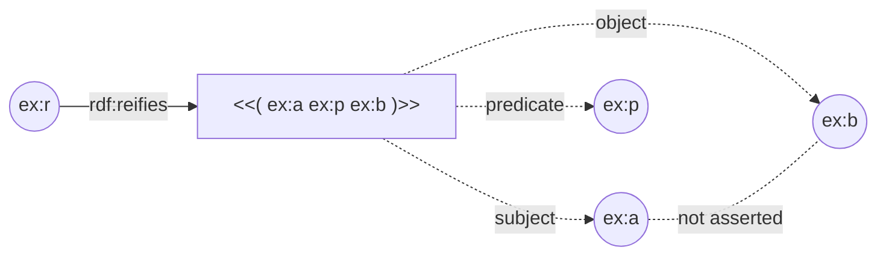
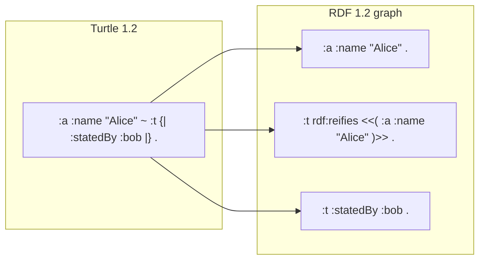
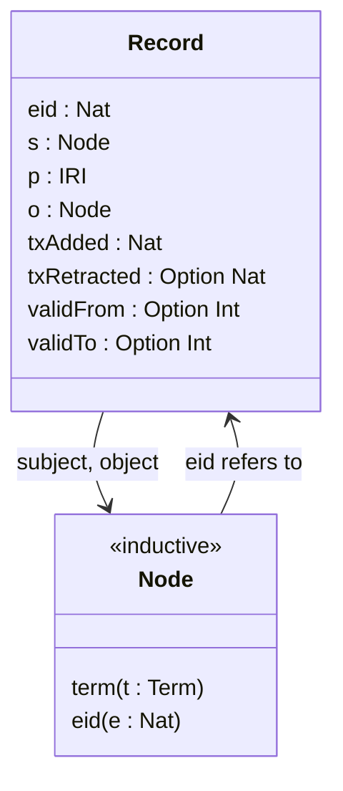
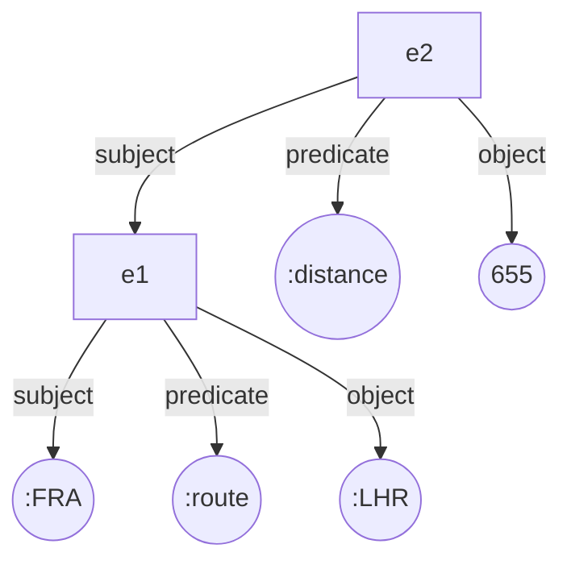
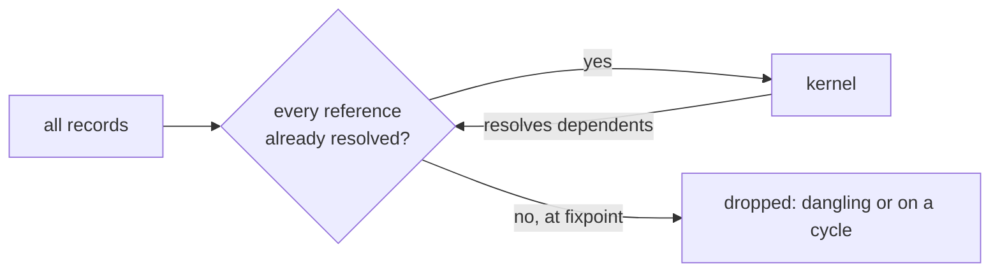

# Concepts

The vocabulary of RDF 1.2 and statement graphs as LeanRDF uses it, planned in [[changes#add-rdf12-core]] and [[changes#add-statement-graphs]]. Each concept is defined once here and cited by the decisions in [[decisions]].

## Triple term

A triple used as an RDF term, written `<<( s p o )>>`. In strict RDF 1.2 it may appear only as an object, and its own subject is an IRI or a blank node.

A triple term *denotes* a proposition through the injective `IT` of a simple interpretation. It is never asserted by appearing: `ex:r rdf:reifies <<( ex:a ex:p ex:b )>>` does not entail `ex:a ex:p ex:b`. In LeanRDF it is the constructor `Term.triple s p o`. `Triple` stays generalized, so derivations may hold triple terms anywhere, while `Triple.WellFormed` keeps the strict positions.

- defines:: [[decisions#Triple terms are a recursive Term constructor]]

## Reifier

The subject of a reifying triple `r rdf:reifies <<( s p o )>>`: an IRI or blank node that names one occurrence of a triple, so other triples can talk about it.

Several reifiers may reify the same triple term; they stay distinct occurrences, while the triple term, like any triple, is one. Turtle 1.2 writes `<< s p o ~ r >>` for the reifying triple alone and `s p o ~ r {| … |}` for the asserted triple, its reifier and the annotations on it.

- defines:: [[decisions#Reifier export is primary]]

## RDF 1.2 Basic

Data with no triple term anywhere: what RDF 1.2 Basic conformance supports, and what every RDF 1.1 document parses to. LeanRDF decides it with `Term.Basic`, `Triple.Basic`, `Graph.Basic` and `Dataset.Basic`.

A Basic graph without directional literals serializes to the same canonical N-Triples as under RDF 1.1, so Basic is how RDF 1.1 guarantees survive inside the one RDF 1.2 model.

- defines:: [[decisions#Strict well-formedness is recursive; Triple stays generalized]]

## Statement record

One stored statement in tiramemsu's sense: an eid, a subject and an object that are each a term or another record's eid, a predicate IRI, and two clocks.

The clocks are a transaction interval `[txAdded, txRetracted)` over transaction numbers and a valid-time interval `[validFrom, validTo)` in epoch milliseconds. A statement graph is a finite set of records with distinct eids. It may hold dangling references (a snapshot) and reference cycles (a correction replay); only self-reference is forbidden.

- defines:: [[decisions#Bitemporal records with eid references]]

## Statement graph

In the sense of Gelling, Fletcher and Schmidt: a directed acyclic graph whose internal vertices are statements with exactly three role edges, and whose leaves are values.

A subject or object edge may point at another statement; the predicate edge may not. A set of statement records has an identity-preserving export to such a graph exactly when it is closed and acyclic. That export is unique, and it is the paper's `thm:criterion`. tiramemsu's own documentation also uses "statement graph" for a named graph named by a statement id. LeanRDF does not use that sense.

- defines:: [[decisions#Vendored abstract proofs, concrete layer on top]]

## View

A selection of what is asserted: a transaction selector (`now`, `asOf t` or `history`) together with a valid-time selector (`unfiltered` or `at d`). A record is live in a view when both of its intervals admit the view.

The reifier export reifies every record and asserts only the live ones, so the same statement graph has one export per view. All of them decode back to the same records.

- defines:: [[decisions#Assertion is derived from a view]]

## Export kernel

The greatest closed, acyclic subset of a set of records: the part that has a Statement Graph export and a quoting image. It is computed by peeling the records whose references cannot be resolved.

The full history of a store built under tiramemsu's write rules is closed, and its cycles stay inside one transaction. A snapshot can dangle, and the kernel shows what quoting would drop.

- defines:: [[decisions#Executable kernel proven against K]]
