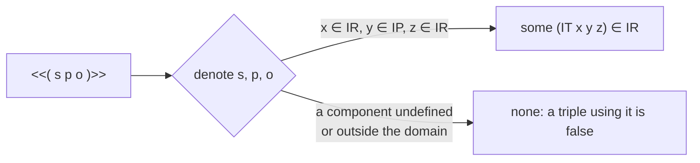
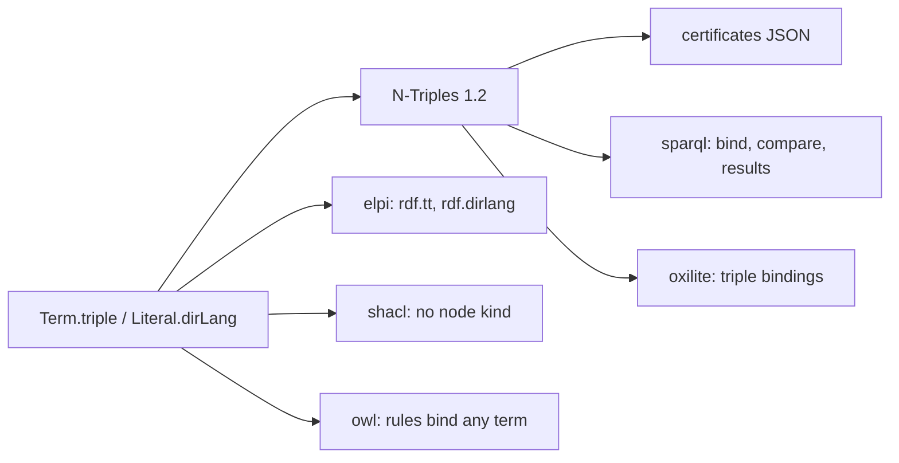
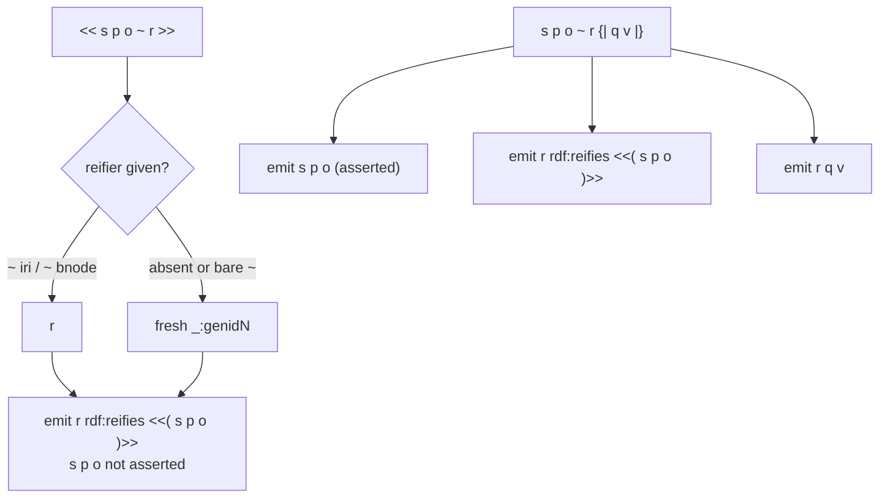
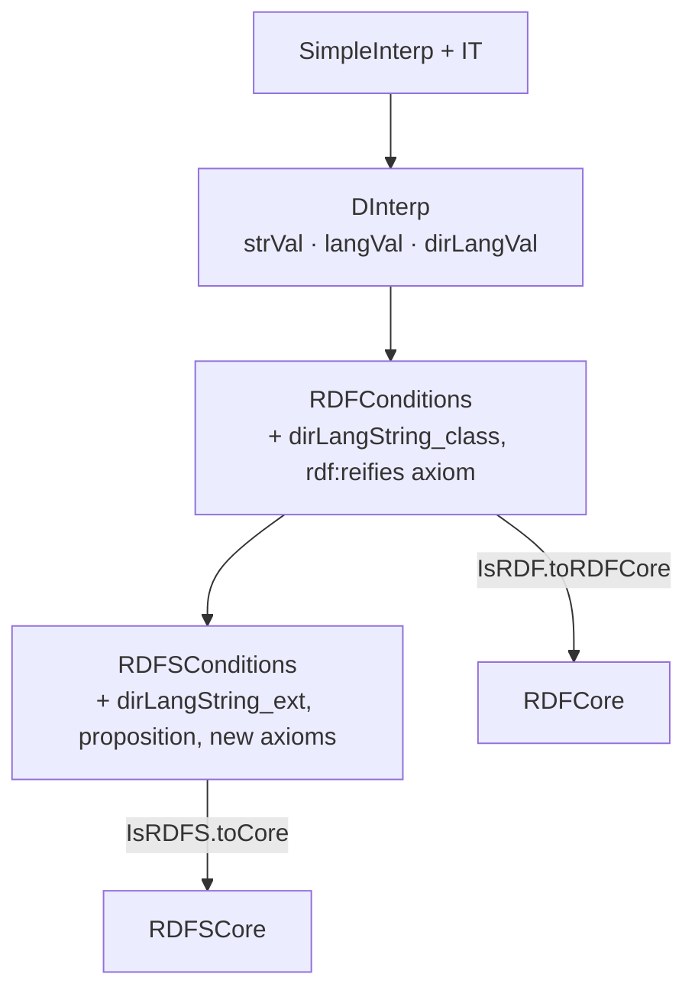
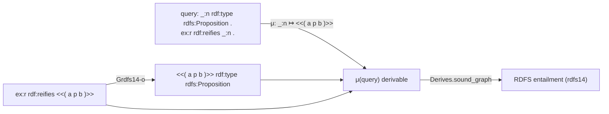
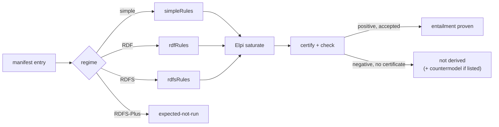
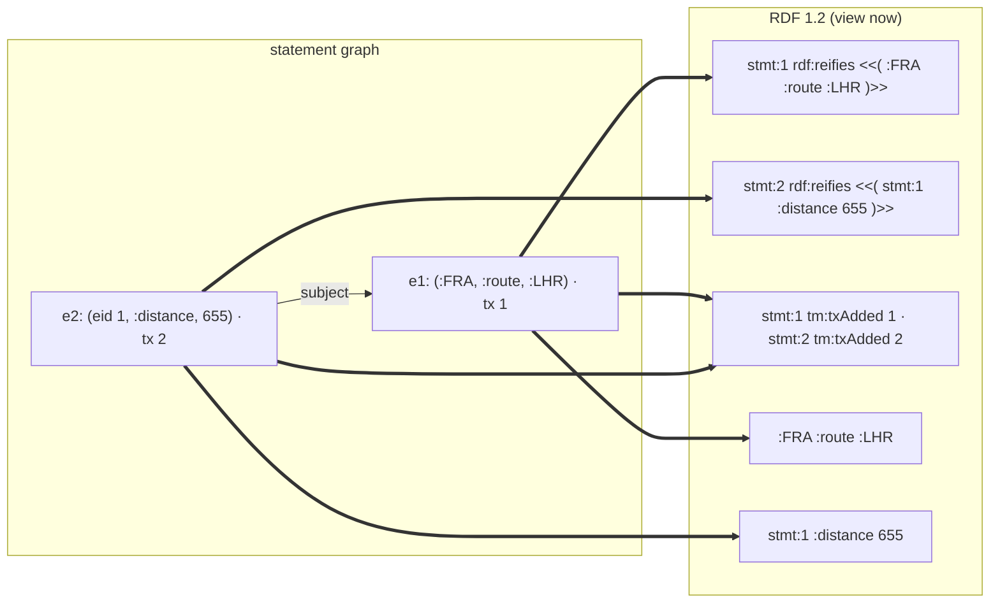
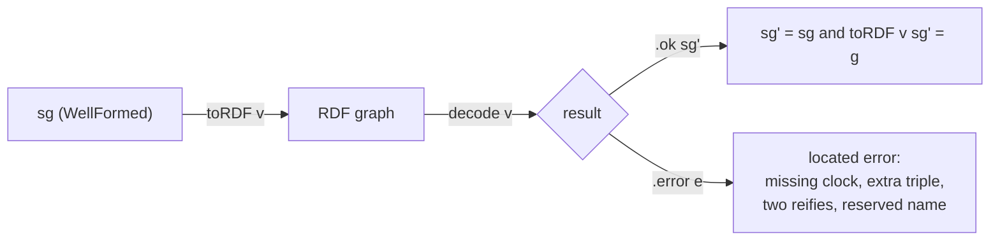
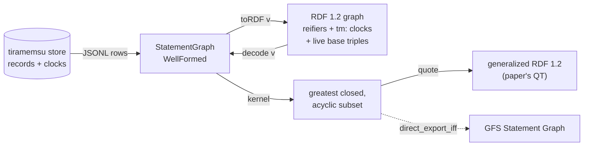

# Decisions

The architecture decisions of LeanRDF, from the design interview of 2026-10-29 over the v0.1 handoff. The rules they answer to are in [[constraints]]; departures from the W3C texts are in [[simplifications]].

Each decision states its context, the choice and its consequences, then typed edges to the constraints and earlier decisions that force it.

## Elpi finds, Lean checks

Search runs in untrusted Elpi code; a result is reported as entailed only when a verified Lean checker accepts its certificate. The trusted base is the kernel, the checker and the semantics.

**Context.** Rule closure needs search, and search code is large and changes often. Proving the search correct would freeze it.

**Decision.** Untrusted: lean-elpi, the generated rule clauses, the saturation driver, any external engine. Trusted: the Lean kernel, `LeanRDF.Semantics`, `Derives` and the certificate checker with its soundness theorem.

**Consequences.** Every search bug shows up as a rejected certificate, never as a wrong answer. The checker and its proofs carry the whole guarantee, so they stay small.

- motivated_by:: [[constraints#Simple interpretations]] {weight: secondary}

## Own checker first, LF backend later

Certificates are proof DAGs checked by a computable Lean function with a soundness theorem; lean-elpi's LF proof terms are a later, optional second backend.

**Context.** lean-elpi offers two routes: plain Elpi returning answers, with the proof built as an explicit argument, or the LF layer, which records proof terms and exports them for the kernel.

**Decision.** Build the DAG certificate and `check`/`check_sound` route first (M4, M5). Keep `Rule` plain data so that an LF signature can be generated from it later. Rejected for now: LF export as the only route, because its proofs are trees without sharing, it accepts certificates only from lean-elpi, and it would need a bridge theorem from the exported inductive to `Derives`.

**Consequences.** External engines such as Nemo or Oxigraph can emit certificates for the same checker. The LF backend stays possible without changing the rule format.

- motivated_by:: [[constraints#LF proof terms are trees]] {weight: primary}
- motivated_by:: [[decisions#Elpi finds, Lean checks]]

## Forward-chaining saturation in Elpi

The Elpi side computes the closure by semi-naive forward chaining, recording each triple's justification in a `std.map`; queries are lookups in the closure.

**Context.** Backward `derive` clauses loop on `rdfs5`, `rdfs7` and `rdfs11` as soon as a graph has a `subClassOf` or `subPropertyOf` cycle, and lean-elpi has no tabling.

**Decision.** A fixed driver `saturate.elpi` applies all rules until no new triple appears, keyed by triple, with value = rule name plus premise triples. The API is `saturate : Graph → Closure` plus a goal lookup, replacing the handoff's "first derivation of the goal". Rejected: visited-set backward search (no sharing, re-searches per query) and iterative deepening (exponential in chain length, complete only up to the bound).

**Consequences.** Termination holds by construction: the rules invent no terms, so the closure has at most |terms|³ triples. The readout is already a proof DAG with sharing. As built, known triples are hypothetical `rdf.known` clauses, the seen set is a `std.set` of printed triples, and rounds are semi-naive.

- motivated_by:: [[constraints#lean-elpi has no tabling]] {weight: primary}

## Own certificate format with a Datalog export

LeanRDF defines its own certificate: nodes with ids, a rule name and premise ids in body order, over N-Triples-style terms. An exporter writes CertifyingDatalog's `GraphProblemInput` for cross-checks.

**Context.** The handoff asked for compatibility with CertifyingDatalog. Its format has no rule names (the checker searches all rules per node), keys nodes by atom, allows constant terms only, and its library needs Mathlib.

**Decision.** Own format and checker in core Lean. Terms serialize as `<iri>`, `_:b`, `"lex"^^<dt>`, `"lex"@lang`, reusing the N-Triples parser. A separate exporter encodes triples as `triple(s,p,o)` and the rules as Datalog for the CertifyingDatalog binary, used as an independent test, not a trust dependency. Rejected: depending on CertifyingDatalog and bridging its Datalog semantics to `Derives`.

**Consequences.** Checking is one pass with one match per node. The project has no Mathlib anywhere, which removes the handoff's exception for `LeanRDF.Cert`. As built: `check_sound` gives `Derives`, `checkQuery_sound` gives RDFS entailment, and Boolean forms (`checkB`, `checkQueryB`) let tests obtain both with `native_decide`, because `Except` has no decidable equality.

- motivated_by:: [[constraints#CertifyingDatalog needs Mathlib]] {weight: primary}
- motivated_by:: [[decisions#Dependency-free core package]]

## Opaque hash-set graph

`Graph` wraps `Std.HashSet Triple` and is opaque: its API is membership, with lemmas `mem_empty`, `mem_insert`, `mem_union`, `mem_singleton` and `mem_ofList`.

**Context.** Hash sets are fast for the checker's "fact ∈ g" test but not extensional, and their iteration order depends on hashing and insertion history.

**Decision.** Proofs and callers use only `∈` and the membership lemmas, never graph equality or the representation. Serializers (N-Triples, certificates) sort triples. Rejected: `ExtHashSet` (extensionality is never needed) and `TreeSet` (O(log n) lookups for an order that sorting gives anyway).

**Consequences.** Round-trips and golden tests are stable regardless of input order. Switching the representation later touches one file.

- motivated_by:: [[constraints#lean-elpi has no dependencies]] {weight: secondary}

## Generalized triples inside

Terms of any kind may appear in any position of a `Triple`; `Triple.WellFormed` and a smart constructor give strict RDF 1.1 triples where the input requires them.

**Context.** Closure under the RDFS rules leaves strict RDF: `rdfs3` concludes `"5" rdf:type C` from a literal object.

**Decision.** `Triple` is generalized, as in the handoff; parsers produce well-formed triples and `Satisfies` is defined for generalized ones.

**Consequences.** Derivations and certificates may contain literal subjects; serializing such a triple to N-Triples is an error, and certificates use their own term syntax.

- motivated_by:: [[constraints#Entailment rules use generalized RDF]] {weight: primary}

## Literals are typed or language-tagged

`Literal` is `typed lex dt | lang lex tag`, so a language tag without `rdf:langString` cannot be represented; parsers and smart constructors lowercase tags.

**Context.** The handoff's structure with `datatype` and `lang : Option String` admits states RDF forbids.

**Decision.** `Literal.datatype` is derived (`.lang` gives `rdf:langString`). `Literal.mk?` rejects `.typed _ rdf:langString`, and parsers use only smart constructors. Language tags are lowercased, which RDF 1.1 Concepts allows. IRIs stay unvalidated strings in Core; the N-Triples parser enforces `IRIREF` and unescapes `\u` and `\U`.

**Consequences.** No well-formedness hypothesis travels with every literal. `"a"@EN` and `"a"@en` are the same term.

- motivated_by:: [[constraints#Language tag iff langString]] {weight: primary}
- motivated_by:: [[constraints#IRIs are RFC 3987 IRIs]] {weight: secondary}

## Single-carrier interpretations

An interpretation has one carrier `Dom : Type` with `IR` and `IP` as predicates on it, a well-typed `IEXT`, `IS` into `IR ∪ IP` and a partial `IL` into `IR`.

**Context.** The handoff sketched `IR` and `IP` as separate types. RDFS needs one element to be both a resource and a property (the `?a` of `rdfs2`), and `IS` has no single target type when they are separate.

**Decision.** `Dom : Type`; `IR IP : Dom → Prop` with `IR` non-empty; `IEXT : Dom → Dom → Dom → Prop` with `IEXT p x y → IP p ∧ IR x ∧ IR y`; `IS : IRI → Dom` into `IR ∪ IP`; `IL : Literal → Option Dom` into `IR`; blank-node assignments `A : BlankNode → Dom` into `IR`. Rejected: `IP ⊆ IR` as a simplification, and two types.

**Consequences.** A direct transcription of §5 with no simplification except the universe level. Proofs get side conditions such as `IR (I y)`, discharged from the well-typedness of `IEXT`.

- motivated_by:: [[constraints#Simple interpretations]] {weight: primary}

## Layered interpretations with a core

`SimpleInterp`, `RDFInterp` and `RDFSInterp` transcribe the spec's condition tables in full; soundness is proved against a minimal `RDFSCore` and lifted.

**Context.** Soundness over a larger class of interpretations is the stronger theorem. The six M3 rules use only the conditions on `rdf:type`, domain, range, `subClassOf` and `subPropertyOf`.

**Decision.** Full structures, citing each condition, including the axiomatic triples as `∀ n` conditions and the two required datatypes through abstract value fields `strVal` and `langVal`. `RDFSCore` holds the conditions the proven rules use; `RDFSInterp → RDFSCore` lifts `Derives.sound`. Each rule added later pulls its conditions into the core.

**Consequences.** The semantics names what it covers honestly, and the proofs stay small. D-entailment beyond the two datatypes is a recorded simplification. Since `add-rdfs-full` the core also holds the RDF condition on `IP`, the axioms and the literal-value consequences of §7.1, so it is derived from `IsRDFS` (`DInterp.IsRDFS.toCore`) rather than from the RDFS conditions alone.

- motivated_by:: [[constraints#RDF interpretations recognize two datatypes]] {weight: primary}
- motivated_by:: [[constraints#RDFS interpretation conditions]] {weight: primary}

## Readings of the condition tables

Where the RDF 1.1 Semantics tables leave room, LeanRDF reads them one fixed way and records it here, so a reader checking the transcription knows what to expect.

**Context.** Some table rows are compressed: "transitive and reflexive on IP", "rdf:_1, rdf:_2, …", and two descriptions of the `rdf:langString` class.

**Decision.** Transitive everywhere and reflexive on `IP` (and on `IC`). Container membership properties are `rdf:_(n+1)` for every `n`, so `rdf:_0` gets no axioms. The `rdf:langString` value space is the pairs with lowercased tags. Blank-node mappings are total into `IR`. RDF and RDFS conditions are Prop structures over a `DInterp`, one field per row.

**Consequences.** Each field cites one row; a disagreement with the spec is a one-field fix.

- motivated_by:: [[constraints#RDF interpretations recognize two datatypes]] {weight: primary}
- motivated_by:: [[constraints#RDFS interpretation conditions]] {weight: primary}

## Small-model family for vacuity

All vacuity countermodels come from one parametric RDFS interpretation over `Term`, in which `rdfs:subClassOf` is inclusion of class extensions; each countermodel only chooses empty classes or properties.

**Context.** Countermodels must satisfy every RDFS condition, including the infinite `rdf:_n` axioms. A canonical-closure model would amount to a completeness proof.

**Decision.** Every element is a resource and a property. Every class contains everything except `xsd:string`, `rdf:langString` and the custom classes. Non-vocabulary properties relate everything except the custom properties. `rdfs:subPropertyOf` is reflexivity plus everything below `rdfs:member` plus the `isDefinedBy` axiom, and domains and ranges are defined against an over-approximation of the extensions. Custom classes must avoid `universalClasses`, the classes the axioms force to be total.

**Consequences.** The model existence theorem, three non-entailments and their RDFS conditions are kernel proofs in `Tests/Semantics/`. A new axiom whose object is a new class must be added to `universalClasses`.

- motivated_by:: [[decisions#Semantics tested against vacuity]] {weight: primary}

## Horn rules matched by the checker

A `Rule` has a name, body and head triple patterns, and decidable guards; rules are range-restricted with unique names, and the checker computes σ by matching premises in body order.

**Context.** The checker must reject wrong instances without searching. Some RDFS 1.1 patterns need side conditions: `rdfs1` and `GrdfD1` need `ddd ∈ D`, and the axiomatic triples for `rdf:_n` need an IRI test.

**Decision.** `Pat := var n | const t`; `Rule := {name, body : List (Pat × Pat × Pat), head, guards : List Guard}` with `Guard` a small closed inductive of decidable predicates, each with a semantic lemma. Guards exist from M3; `add-rdfs-full` gives them three constructors (container membership IRI, `xsd:string` literal, language-tagged literal), each decided by `Guard.check` and proven by `Guard.check_sound`. Axiomatic triples are rules without premises. `check` matches each body pattern against its premise's conclusion, fails on inconsistent bindings, evaluates guards, and compares `σ(head)` with the node's conclusion. Every RDFS 1.1 pattern is Horn: `rdfD1` is replaced by `GrdfD1` over generalized RDF.

**Consequences.** `check_sound` rests on one matching lemma, `match p t = some σ → σ.apply p = t`. Adding the remaining RDFS rules in `add-rdfs-full` changes no format.

- motivated_by:: [[constraints#Entailment rules use generalized RDF]] {weight: primary}
- motivated_by:: [[decisions#Own certificate format with a Datalog export]]

## Rules generated from Lean

The Lean `List Rule` is the single source of truth: a Lean function emits one Elpi `step` clause per rule, and a fixed hand-written driver runs the saturation.

**Context.** A hand-written `rdfs.elpi` duplicates the proven rules; drift is never unsound but shows up as certificates the checker rejects.

**Decision.** `stepClauses : Rule → Except String (List String)` generates clauses asserted at load time; `saturate.elpi` is hand-written and rule-independent. Terms cross through a hand-written encoding ([[decisions#Hand-written Elpi term encoding]]). Rejected: hand-written rules, and a generic rule interpreter in Elpi (loses indexing).

**Consequences.** New rules, including OWL RL later, are a Lean change only. The generator is untrusted like the rest of the Elpi side.

- motivated_by:: [[decisions#Horn rules matched by the checker]]
- motivated_by:: [[decisions#Elpi finds, Lean checks]]

## Hand-written Elpi term encoding

RDF terms cross to Elpi through a hand-written encoder and decoder with `rdf.`-prefixed constructors, not through `deriving Elpi`.

**Context.** The interview assumed `deriving Elpi` on `IRI`, `Literal`, `Term` and `Triple`. Derived names follow the Lean names, so the kind would be `term`, which lean-elpi uses for Lean expressions, and the constructors would be bare `iri`, `bnode`, `lit`.

**Decision.** `encodeTerm`/`decodeTerm` over `rdf.iri S`, `rdf.bnode L`, `rdf.typed Lex Dt`, `rdf.lang Lex Tag`, and `rdf.t S P O` for triples, declared in `saturate.elpi`. Literals are flattened into the term kind. Decoding is untrusted.

**Consequences.** About 30 lines instead of four `deriving` clauses, and no name clashes. The certificate checker never sees Elpi terms.

- motivated_by:: [[constraints#Derived Elpi names follow the Lean names]] {weight: primary}
- motivated_by:: [[decisions#Elpi finds, Lean checks]]

## Axiom-clean library

Library theorems use only `propext`, `Quot.sound` and `Classical.choice`; `native_decide` is allowed only under `Tests/`, and the runtime guarantee is "verified checker, compiled".

**Context.** `check` returns `Except String Triple`. Kernel `decide` cannot evaluate it on hash-set graphs; `native_decide` adds `Lean.ofReduceBool` and trusts the compiler.

**Decision.** A test runs `#print axioms` on `Derives.sound`, `check_sound` and the other key theorems and fails on any other axiom. Golden tests may use `native_decide` to state `Derives rdfsRules g t` and `g.RDFSEntails h` for concrete graphs. The demo trusts the compiled checker and says so. No kernel-reducible checker in v0.x.

**Consequences.** The library claims exactly what is proven; tests show the propositions are obtainable; the compiler is a named part of the runtime trust base.

- motivated_by:: [[constraints#String hash is opaque to the kernel]] {weight: primary}

## N-Triples first, native Turtle later

M2 is a native N-Triples parser and serializer, tested on the W3C `rdf-n-triples` suite; Turtle is a native parser in M7, after the demo; the oxrdfio bridge is dropped.

**Context.** Turtle adds prefixes, base resolution, abbreviations and collections. The handoff's fallback, an FFI bridge to oxrdfio, would add Rust and break the dependency-free core.

**Decision.** Vendor the W3C N-Triples suite under `Tests/data/` and run all positive and negative syntax tests. Round-trip stability means `parse ∘ serialize ∘ parse = parse` as graphs compared by membership, with blank-node labels preserved. M7 uses the `rdf-turtle` suite the same way.

**Consequences.** The critical path to the demo stays short; Turtle reuses the N-Triples terminals. As built (M7), the Turtle parser passes all 313 W3C Turtle tests, resolves relative IRIs by RFC 3986 §5.2, keeps numeric lexical forms as written, and names generated blank nodes `genidN` away from document labels.

- motivated_by:: [[decisions#Dependency-free core package]]

## Recursive-descent N-Triples parser

The N-Triples parser is hand-written recursive descent over a character array, building terms only through the Core smart constructors, with line and column in every error.

**Context.** M2 needs exact conformance to the W3C suite and errors a user can act on, with no dependencies.

**Decision.** A `ReaderT (Array Char) (StateT Nat (Except (Nat × String)))` monad with `partial` loops (no proofs about the parser in v0.x). IRIs must be absolute, and escaped characters IRIREF forbids raw are rejected. Blank-node labels exclude `:` and give trailing dots back to the triple. The W3C suite is vendored with a generated index and runs on every `lake test`. Rejected: `Lean.Parsec` (no positions in errors) and parser-combinator packages (dependencies).

**Consequences.** All 41 positive and 29 negative W3C tests pass. `parse` only ever yields well-formed triples.

- motivated_by:: [[constraints#N-Triples grammar]] {weight: primary}
- motivated_by:: [[constraints#W3C tests reject colons in blank-node labels]]
- motivated_by:: [[decisions#Literals are typed or language-tagged]]

## Canonical N-Triples output

The serializer writes only canonical N-Triples and returns an error instead of output that would not re-parse; `Term.toNTriples` is the shared term syntax for certificates.

**Context.** Round-trip stability (M2) and readable certificates (M5) both need one deterministic term syntax.

**Decision.** `Graph.toNTriples` writes `Graph.toList` order, one ` .`-terminated line per triple, no UCHAR, ECHAR for exactly four characters and no `^^xsd:string`. It fails on non-well-formed triples, non-absolute IRIs, IRIs with forbidden characters, and invalid labels or tags. `Term.toNTriples` writes any term in any position, so generalized triples in certificates use the same syntax.

**Consequences.** Parse, serialize, parse, serialize is a fixed point on the whole W3C corpus.

- motivated_by:: [[constraints#N-Triples grammar]] {weight: primary}
- motivated_by:: [[decisions#Opaque hash-set graph]]

## Graph queries with instance mappings

An entailment query is a graph `h`; its certificate adds a mapping `μ` of `h`'s blank nodes to terms and one derivation per triple of `μ(h)`.

**Context.** The handoff's theorem covers one triple. Real queries are graphs with existential blank nodes, and later SPARQL basic graph patterns need the same shape.

**Decision.** `Derives.sound_graph : (∀ t ∈ h, Derives rdfsRules g (μ.apply t)) → g.RDFSEntails h`, from one extra lemma: `I ⊨ μ(h)` implies `I ⊨ h` with assignment `[I+A] ∘ μ`. Unmapped blank nodes map to themselves, which is still an instance mapping, so the checker needs no coverage check. Finding `μ` is an untrusted join over the closure. The single-triple theorem is the case `h = {t}`.

**Consequences.** The demo answers real queries, and `LeanSPARQL` gets its entry point.

- motivated_by:: [[constraints#Entailed blank nodes are existential]] {weight: primary}

## Specs and typed docs over a design file

Each milestone is an OpenSpec change, requirements and scenarios live in capabilities, and decisions, constraints and simplifications live in `tg.md/`; there is no separate `DESIGN.md`.

**Context.** The handoff asked for `docs/DESIGN.md` and `docs/integration-contract.md`. The repository is already set up for OpenSpec and the tg typed graph, as lean-elpi is.

**Decision.** Changes per milestone (listed in [[changes]]), archived when their acceptance criteria pass, which is also the commit point. Code carries `@tg: implements::`, tests carry `@tg: verifies::`, and `tg trace --gaps` is the acceptance check. Task 0's answers are [[integration-contract]]. Departures from the spec are `Simplification` sections, a type added to `Types/` for this.

**Consequences.** The handoff's conventions (cite the spec, record blockers, do not widen scope silently) become things `tg check` and `tg trace` verify. `docs/DESIGN.md` is a short pointer.

## Dependency-free core package

The repository holds two Lake packages: `leanrdf` at the root with no dependencies, and `leanrdf-elpi` under `elpi/`, which requires `leanrdf` by path and lean-elpi from git at `v0.3.3`.

**Context.** A Lake `require` applies to the whole package; users of the model and checker, and the later layers, do not need Elpi.

**Decision.** The core package holds Core, Parse, Semantics, Entailment and Cert and never imports `Elpi`. The bridge package holds the encoding, generated rules, the driver, the demo and the end-to-end tests. A commented path override in `elpi/lakefile.lean` switches to a sibling lean-elpi checkout for local work. No Batteries: Lean core `Std` suffices.

**Consequences.** "Core has no dependencies" is a property of the build. Test libraries need distinct module names (`Tests`, `BridgeTests`) because Lake resolves modules across packages.

- motivated_by:: [[constraints#Lake requires per package]] {weight: primary}
- motivated_by:: [[constraints#lean-elpi has no dependencies]]
- motivated_by:: [[constraints#Lean toolchain 4.35]]

## Static site from a standard-library generator

The documentation site (home, a fifteen-chapter book, a documentation section, examples, reference, roadmap) is Markdown in `site/content/`, built by `site/build.py` with the Python standard library and published to GitHub Pages by a workflow.

**Context.** The library needs an introduction to RDF semantics in Lean that people can read without a checkout. lean-elpi already uses a small standard-library generator; `docs/` here holds design files, not site output.

**Decision.** Reuse lean-elpi's generator design with a Lean highlighter, write output to the ignored `_site/`, and deploy it with `actions/deploy-pages` on pushes that touch `site/`. The logo is an SVG entailment turnstile whose bars end in graph nodes. Book examples are adapted from the test suite, and demo output is copied from a real run. The book and the documentation are ordered sections with a contents sidebar, built by one `section` function; the documentation is the manual (tools, API per package, formats, testing, contributing) and the book explains the ideas. The German legal pages (Impressum, Datenschutzerklärung, AGB) and an English privacy page are copied from pavlyshyn.me, adapted to this site's links and fonts, linked from every page's footer and served with `lang: de` where German. Snippets on the documentation pages are compiled from `Tests/Guide/`, `SparqlTests/Examples.lean`, `ShaclTests/Examples.lean` and `BridgeTests/CustomRule.lean`.

**Consequences.** No build dependencies and no committed output. A change to the library's API must be reflected in the book by hand.

- motivated_by:: [[decisions#Dependency-free core package]] {weight: secondary}

## Semantics tested against vacuity

M3 cannot be archived without kernel-checked evidence that the semantics is not vacuous: a model exists, some non-entailments hold, and each rule's entailment has a hand proof.

**Context.** If the transcribed RDFS conditions were unsatisfiable, every entailment would hold and `Derives.sound` would be trivially true. Soundness alone cannot detect it.

**Decision.** `Tests/Semantics/` holds, without `native_decide`: a concrete `RDFSInterp` satisfying a nontrivial graph; at least three `¬ g.RDFSEntails h` with countermodels (`{a subClassOf b} ⊭ {b subClassOf a}`, `{x type C} ⊭ {x type D}`, a domain case that must not fire); and one semantic hand proof per rule. All countermodels come from one canonical small-model construction over the graph's terms, the vocabulary and a token for each `rdf:_n`.

**Consequences.** M3 costs more, and catches the transcription errors that matter most.

- motivated_by:: [[decisions#Layered interpretations with a core]]

## No datasets in v0.x

LeanRDF v0.x has graphs only; datasets return together with N-Quads and named-graph semantics as one change.

**Context.** The handoff made datasets optional in M1 while keeping named-graph semantics out of scope.

**Decision.** No `Dataset` type, no N-Quads.

**Consequences.** No unused surface to keep in sync with parsers and semantics.

## Demo never claims non-entailment

`lake exe leanrdf-demo DATA.nt QUERY.nt [--cert OUT.json] [--datalog OUT.json]` prints the verdict, `μ` and the pruned certificate. A missing derivation means "not derived", never "not entailed".

**Context.** Completeness is not proven in v0.x, so a failed search proves nothing about entailment.

**Decision.** Exit codes: `0` entailed and checked, `1` not derived, `2` certificate rejected (a bug on the untrusted side), `3` input or parse error. The certificate is pruned to nodes reachable from the goals. A small ontology and three queries live in `elpi/examples/`.

**Consequences.** The demo's output is exactly as strong as what is proven. As built, `Demo.verdict` (the checker) is the only source of exit codes `0` and `2`, a failed Elpi run also exits `2`, and the logic lives in `LeanRDF.Demo.run` so tests drive it without processes.

- motivated_by:: [[decisions#Graph queries with instance mappings]]
- motivated_by:: [[decisions#Own certificate format with a Datalog export]]

## LeanRDF is the proof layer for oxilite

LeanRDF does not become a database. oxilite stores, queries and reasons; LeanRDF checks what oxilite claims, and gives SPARQL a semantics and a reference evaluator to test oxilite against.

**Context.** oxilite (github.com/Volland/oxilite) is an Oxigraph-compatible SPARQL store on SQLite with RDFS and OWL-QL rewriting, OWL 2 RL materialization, Datalog and SHACL, and a `why` tool that explains inferences as proof trees. A second store in Lean would duplicate it without making it more trustworthy.

**Decision.** The roadmap after v0.1 (`tg.md/changes.md`, the site's roadmap page) certifies oxilite's answers and explanations, proves a SPARQL evaluator against the algebra semantics and compares oxilite with it, and extends the proven rules to OWL 2 RL and EL and SHACL Core. LeanRDF talks to oxilite only through its command line and MCP tools; no change to oxilite is required.

**Consequences.** "Elpi finds, Lean checks" generalizes to "oxilite finds, Lean checks". Certification proves soundness of answers, never completeness; completeness questions are answered by the proven SPARQL evaluator, not by certificates.

- motivated_by:: [[decisions#Own checker first, LF backend later]]
- motivated_by:: [[decisions#Demo never claims non-entailment]] {weight: secondary}

## Layers as packages in one repository

SPARQL, OWL and SHACL are Lake packages in this repository (`sparql/`, `owl/`, `shacl/`), each requiring the core by path, rather than separate repositories.

**Context.** The layers reuse `Rule`, `Derives`, the certificate checker and the parsers, and building them changes those. Lean packages must share one toolchain.

**Decision.** One repository, one package per layer, one CI. A layer moves to its own repository only when it gets its own contributors or release cadence, or a heavy dependency (Mathlib, an FFI).

**Consequences.** A core change and its users land in one commit. Downstream users still fetch only the packages they require, with `require … from git … / "owl"`.

- motivated_by:: [[constraints#Lake requires per package]] {weight: primary}
- motivated_by:: [[decisions#Dependency-free core package]]

## Dual licence, CI and a tagged release

LeanRDF is licensed `MIT OR Apache-2.0`, built and tested by CI in both packages on every push, and released as `v0.1.0` from a public repository.

**Context.** The site links to the source, downstream lakefiles need a tag to pin, and lean-elpi (Apache-2.0) and oxilite (MIT or Apache-2.0) set the licence norm.

**Decision.** The dual licence of oxilite, `LICENSE-MIT` and `LICENSE-APACHE` at the root and in both lakefiles' metadata. `.github/workflows/ci.yml` runs `leanprover/lean-action` for the root package and for `elpi/`, checks the release contract with `scripts/check_release.py`, then runs the demo. Reservoir eligibility is not a CI gate: it needs a licence GitHub detects as one SPDX identifier and at least two stars, neither of which a build can fix. The repository went public after a scan of the tree and history found no secrets.

**Consequences.** Every later change is checked by CI. A package added under the roadmap needs its own CI job.

- motivated_by:: [[decisions#Dependency-free core package]]
- motivated_by:: [[decisions#Layers as packages in one repository]] {weight: secondary}

## Datasets as sets of quads

`Quad` is a triple with `g : Option Term`, and `Dataset` an opaque set of quads used through `mem_*` lemmas, like `Graph`. Default, named and union graphs are views of it.

**Context.** SPARQL (`GRAPH`, `FROM NAMED`) and oxilite's per-ontology graphs need named graphs, which [[decisions#No datasets in v0.x]] left out.

**Decision.** One hash set of quads, not a map from names to graphs: one lemma set, and N-Quads is quads already. An empty named graph is not represented, since no syntax here produces one. N-Quads shares the N-Triples statement parser, with the graph label allowed only in N-Quads mode. Datasets get no model theory, because RDF 1.1 defines none.

**Consequences.** `Dataset.ofGraph` embeds every graph; entailment remains between graphs.

- supersedes:: [[decisions#No datasets in v0.x]] {since: "add-datasets", reason: "SPARQL and oxilite need named graphs"}
- motivated_by:: [[decisions#LeanRDF is the proof layer for oxilite]]
- motivated_by:: [[decisions#Recursive-descent N-Triples parser]] {weight: secondary}

## TriG on the Turtle statement parser

TriG is parsed by the Turtle parser with a current graph in its state: Turtle statements emit quads into that graph, and TriG adds blocks, `GRAPH` and graph labels around them.

**Context.** TriG §5 reuses Turtle's statements, terms, prefixes and IRI resolution; a second copy would drift.

**Decision.** The parser state holds `graph : Option Term` and `quads`. `directive` is shared; `block` handles `{ … }`, `GRAPH label { … }`, `label { … }`, `[] { … }` and triples in the default graph. Generated blank nodes are renamed over graph names too. `@prefix` and `@base` are lexed as whole tokens, so `@prefix:` is the empty prefix (found by the W3C TriG suite, harmless for Turtle).

**Consequences.** `Turtle.parse` is unchanged in behaviour (its 313 W3C tests still pass) and `TriG.parse` passes the 357 TriG tests.

Since add-rdf12-syntax, reified triples and annotations are expanded by the same statement parser, so their `rdf:reifies` triples land in the graph of the statement that yields them.
- motivated_by:: [[decisions#N-Triples first, native Turtle later]]

## Exact XSD values with proven canonical forms

Integers are `Int`, decimals `Rat`, floats and doubles `Float`, and the lexical forms of the exact types are parsed and printed on character lists so that round trips are theorems.

**Context.** SPARQL `FILTER` and `ORDER BY` and SHACL range constraints compare values, not lexical forms; a comparison that is wrong on integers would make every query result suspect.

**Decision.** `Literal.value?` maps the supported datatypes; `XsdValue.compare?` promotes along integer, decimal, float and double. Proven: `parseInteger_canonical`, `parseDecimal_canonical`, `parseBoolean_canonical`, and `compare_integer_iff`/`compare_decimal_iff` (agreement with the order of `Int` and `Rat`). Floats are tested, not proven; the canonical double is the shortest decimal that reads back to the same float. `dateTime` compares on the UTC timeline with the XSD 1.1 rule for a missing timezone.

**Consequences.** Values live beside the model theory, not in it; see [[simplifications#Three recognized datatypes with abstract values]].

- motivated_by:: [[constraints#XSD datatypes]] {weight: primary}
- motivated_by:: [[constraints#SPARQL operator mapping]]
- motivated_by:: [[decisions#LeanRDF is the proof layer for oxilite]] {weight: secondary}

## Two ways to certify oxilite's answers

`leanrdf-oxilite` certifies each answer oxilite gives under RDFS reasoning from oxilite's own `why` tree (mode `why`) and from an Elpi certificate (mode `elpi`); an answer is certified when the checker accepts either.

**Context.** oxilite needs no change for either: `oxilite query --reasoning rdfs` gives the answers, and `oxilite mcp` serves `why`, whose trees name OWL 2 RL templates and their premises.

**Decision.** The query is a Turtle pattern whose blank nodes are variables, rendered as `SELECT *`, so no SPARQL parser is needed yet. A `why` step is translated by trying the rules (template names only order the attempts) against every order of its premises with `Cert.checkNode`, so a translated step is one the checker accepts; notes, `absent` nodes and unmatched steps make an answer `untranslated`. Running oxilite (a temporary project and store, one MCP session) is plumbing whose failures exit with 3; recorded outputs (`--record`, `--results`, `--why-dir`) let `lake test` replay oxilite 0.9.1 without it.

**Consequences.** "oxilite finds, Lean checks" holds for RDFS today. A certified answer is proven sound, never complete: oxilite may return fewer answers than RDFS entails.

- motivated_by:: [[decisions#LeanRDF is the proof layer for oxilite]] {weight: primary}
- motivated_by:: [[decisions#Demo never claims non-entailment]]
- motivated_by:: [[decisions#Own certificate format with a Datalog export]] {weight: secondary}

## A proven reference evaluator for SPARQL

`leanrdf-sparql` specifies SPARQL 1.1 by transcribing §18.5 on lists up to permutation, and proves its evaluator equal to it: `evalN_perm` for every pattern, `runQuery_answer` for every query.

**Context.** Answers that depend on absence (`OPTIONAL`, `MINUS`, `NOT EXISTS`) cannot be certified one at a time, so the evaluator itself must be proven to be useful as a reference for oxilite.

**Decision.** Mappings are strictly sorted association lists (equal mappings are equal lists). The BGP specification enumerates assignments over the graph's terms; the evaluator matches triple patterns one at a time, and `bgp_perm` proves them equal as multisets. `EXISTS` uses substitution (§18.6) with fuel, one unit per nesting level, so it stays inside the proof. ORDER BY keys are lexicographic triples in `Nat × Rat × String`, a proven total preorder, so `orderBy_sorted` follows from `List.pairwise_mergeSort`, and a query's answer is any sorted permutation (`Spec.Answer`), since SPARQL leaves ties open. A bind join was dropped: a VALUES row may bind a BGP's blank-node variable, which the semantics projects away but a bind join would constrain.

**Consequences.** Expressions are one function shared by the specification and the evaluator, so they are tested, not proven. The evaluator is a reference for small data, not a production engine.

- motivated_by:: [[decisions#LeanRDF is the proof layer for oxilite]] {weight: primary}
- motivated_by:: [[constraints#SPARQL algebra]]
- motivated_by:: [[decisions#Layers as packages in one repository]] {weight: secondary}

## SPARQL syntax, extensions and the W3C suite

SPARQL 1.1 queries are parsed by a hand-written recursive-descent parser, translated to the algebra by §18.2, run through the proven evaluator, and checked on the W3C query suite with a skip list that names a reason for every skipped test.

**Context.** The proven core needs real queries: the W3C suite and oxilite both speak full SPARQL, with property paths, aggregates and subqueries that the core semantics leaves out.

**Decision.** Paths, grouping with aggregates and subqueries are pattern constructors whose operators are shared by the specification and the evaluator, applied to the evaluator's sub-results on both sides, so `evalN_perm` stays unconditional and says nothing about them. MD5 and the SHA functions are implemented, so the only skips are subqueries whose expected results are RDF/XML. A test on the skip list that passes fails the build. `scripts/sparql-diff.sh` runs every evaluation test on oxilite too; the committed `sparql/diff-report.md` lists the differences, and a difference counts as a LeanRDF bug only if oxilite matches the expected result and LeanRDF does not.

**Consequences.** 97 of 97 syntax tests and 257 evaluation tests pass (10 skipped for RDF/XML). Against oxilite 0.9.1, 234 tests agree, LeanRDF has no bug, and five oxilite differences and one oxilite parse error are leads for oxilite.

- motivated_by:: [[decisions#A proven reference evaluator for SPARQL]] {weight: primary}
- motivated_by:: [[constraints#SPARQL grammar]]
- motivated_by:: [[decisions#LeanRDF is the proof layer for oxilite]]

## OWL 2 RL as sound rules over a subset of the RDF-Based conditions

`leanrdf-owl` transcribes the OWL 2 RDF-Based Semantics conditions the OWL 2 RL rules need, encodes the fixed-arity OWL 2 RL/RDF rules as `Rule` values, and proves each sound, so `Derives owlRules g t` gives `g.OWLEntails {t}`.

**Context.** oxilite materializes an OWL 2 RL closure, and its `why` trees name OWL 2 RL templates. Certifying them needs rules the checker knows and a semantics they are sound for.

**Decision.** `OWLConds` keeps one field per condition, and where the semantics states an "iff" it keeps only the consequences the rules use: for `rdfs:domain`, `rdfs:range` and `owl:equivalentProperty` these are rule-shaped (a domain extends along `rdfs:subClassOf`; mutual subproperties are equivalent), not the extensional reverse direction. Every field follows from the full semantics, so soundness carries over to full OWL 2 RDF-Based entailment, and a concrete model (`OwlTests/Model.lean`) shows the fields are satisfiable together. The rules are 49 derivation rules plus the OWL axiomatic triples, on top of the 67 RDFS rules (`owlRules`, 127). Rules over `rdf:List` premises and the inconsistency rules are left out. The bridge takes `--profile owl` and certifies oxilite's materialized closure one triple at a time with `--materialized`.

**Consequences.** On the recorded sample, oxilite's answers and 18 of its 31 materialized inferences are certified. The other 13 type a resource as `owl:Thing`, which OWL 2 RL has no rule for (oxilite's `why` names no template), so they are `not derived`.

- motivated_by:: [[decisions#Two ways to certify oxilite's answers]] {weight: primary}
- motivated_by:: [[constraints#OWL 2 RDF-Based Semantics]]
- motivated_by:: [[constraints#OWL 2 RL rules]]
- motivated_by:: [[decisions#Layers as packages in one repository]] {weight: secondary}

## SHACL Core with a validator proven against its semantics

`leanrdf-shacl` states when a focus node conforms to a shape as propositions (`Conforms`), and proves that its validator reports no result exactly then (`results_nil`), so a report's "conforms", which is a claim about absence, is a theorem too.

**Context.** oxilite validates with SHACL through rudof, and nothing checks the reports. A violation can be certified on its own, but "conforms" cannot, so the validator itself has to be proven.

**Decision.** Shapes are a finite tree: references to other shapes hold the shapes, and a recursive shape is a read error, as SHACL §3.4 allows. Paths are an inductive relation `ValueNode`, and the computed value nodes are proven exact (`valueNodes_iff`), with a fixpoint for `*` and `+` paths whose termination is bounded by the terms of the graph. Counts are stated with lists without duplicates. Checks of a single term (datatype, ranges, lengths, patterns, languages, `sh:in`) are functions shared by the semantics and the validator, as SPARQL expressions are. `validate_conforms` and `validate_sound` follow, with only Lean's standard axioms. The W3C suite runs as compiled code in the `lake test` driver, since the interpreter takes about a minute on the self-validating `shacl-shacl` test.

**Consequences.** All 98 W3C SHACL Core tests pass with an empty skip list. On the two recorded samples, oxilite (rudof) and LeanRDF agree on every result's focus node, path and component. Only `"true"^^xsd:boolean` turns a boolean parameter on (`uniqueLang-002`).

- motivated_by:: [[decisions#LeanRDF is the proof layer for oxilite]] {weight: primary}
- motivated_by:: [[constraints#SHACL Core]]
- motivated_by:: [[decisions#A proven reference evaluator for SPARQL]] {weight: secondary}
- motivated_by:: [[decisions#Layers as packages in one repository]] {weight: secondary}

## EL classification by fixed-length lists and certified subsumptions

`owlELRules` adds ten EL completion rules to `owlRules`, over intersection lists of two or three classes and existential restriction nodes, and `leanrdf-classify` certifies each derived subsumption between named classes before printing it.

**Context.** OWL 2 RL cannot classify ontologies built from intersections and existentials, the shape of OWL 2 EL. Their RDF encoding uses `rdf:first`/`rdf:rest` lists, and `Rule` has a fixed number of premises.

**Decision.** `OWLConds` gains the forward direction of the §5.4 condition for `owl:intersectionOf` over sequences (`ListOf`), on resources. Rules match lists of length two or three in full, down to `rdf:nil`, so every list a rule reads is a sequence and the condition applies; a partial-list rule would be unsound. The rules are intersection elimination (each conjunct, both lengths), introduction (both lengths), existential monotonicity, existentials through subproperties, and `owl:Nothing` through existentials. Each is proven sound against `OWLCore`. Classification saturates once with Elpi and certifies each subsumption as its own query; an uncertified one is reported, never printed as part of the hierarchy.

**Consequences.** On the example ontology, all 20 subsumptions and both unsatisfiable classes computed by hand are derived and certified, and `:Mother ⊑ :Parent` needs the EL rules. Intersections of more than three classes, role chains and nominals are out of scope. The OWL model of the non-vacuity tests interprets `owl:intersectionOf` as empty.

- motivated_by:: [[decisions#OWL 2 RL as sound rules over a subset of the RDF-Based conditions]] {weight: primary}
- motivated_by:: [[constraints#OWL 2 EL profile]]
- motivated_by:: [[constraints#OWL 2 RDF-Based Semantics]]
- motivated_by:: [[decisions#Forward-chaining saturation in Elpi]] {weight: secondary}

## Runnable examples with recorded outputs

`examples/` holds one runnable example per command-line tool, and `scripts/examples.sh` compares each run's output and exit code with a recorded copy in `expected/`; CI runs it in the package jobs.

**Context.** The book and documentation quote tool output, and an example that silently drifts from the tools teaches the wrong thing. oxilite is not available in CI.

**Decision.** Every example run writes its output followed by `# exit N` to `examples/<dir>/expected/<name>.txt`; `--update` rewrites them after an intended change. The oxilite example replays outputs recorded by `scripts/examples-record.sh` (`--results`, `--why-dir`, `--inferred`), as the bridge tests do. Lean examples of the library APIs live in the test libraries, so `lake test` compiles them.

**Consequences.** A behaviour change in any tool shows up as a diff in CI. Re-recording after an oxilite upgrade turns a change in oxilite's answers or explanations into a reviewable diff; the first recording already shows a circular `why` explanation.

- motivated_by:: [[decisions#Static site from a standard-library generator]] {weight: primary}
- motivated_by:: [[decisions#Two ways to certify oxilite's answers]]
- motivated_by:: [[constraints#oxilite explanations can be circular]] {weight: secondary}

## Aggregate errors follow §18.5 literally

An error among the values of `SUM`, `AVG`, `MIN`, `MAX` or `GROUP_CONCAT`, including an unbound variable, makes the aggregate an error, and `COUNT` counts the values that are not errors.

**Context.** §18.5 evaluates the aggregate's expression on every solution of the group, and evaluating an unbound variable is an error (§17.2). Oxigraph and oxilite skip unbound values instead, so `AVG(?pages)` over a group where one book has no page count differs between the engines.

**Decision.** Follow the text: `aggregateValue` is shared by the semantics and the evaluator and reads §18.5 literally. The W3C test `agg-err-01` expects this behaviour for a non-numeric value.

**Consequences.** `examples/sparql-library/2-books-per-author.rq` leaves an average unbound where oxilite answers 204; the SPARQL chapter and the documentation explain the difference instead of hiding it.

- motivated_by:: [[constraints#SPARQL algebra]] {weight: primary}
- motivated_by:: [[constraints#SPARQL expressions]]
- motivated_by:: [[decisions#SPARQL syntax, extensions and the W3C suite]] {weight: secondary}

## Triple terms are a recursive Term constructor

`Term` gains `triple (s p o : Term)`, a direct recursive constructor rather than one holding a `Triple`, so `Term` and `Triple` are not mutually inductive and `deriving` keeps working.

**Context.** RDF 1.2 Concepts makes a triple usable as a term. About 34 files in five packages match on `Term` exhaustively.

**Decision.** `inductive Term | iri | bnode | lit | triple (s p o : Term)` with `DecidableEq`, `Hashable`, `Ord` and `Repr` derived. `Triple.toTerm` and `Term.asTriple?` convert. Rejected:
- `triple (t : Triple)`, which brings mutual induction and hand-written instances;
- a separate `Term12`, which means two models, with every proof needed twice;
- a generic `Term α`, which changes every signature.

**Consequences.** Every exhaustive match gains a case in one change. Blank-node renaming and isomorphism recurse into triple terms.

- motivated_by:: [[constraints#RDF 1.2 triples and triple terms]] {weight: primary}
- supersedes:: [[decisions#Generalized triples inside]] {reason: "Triple stays generalized, WellFormed becomes recursive"}
- introduced_by:: [[changes#add-rdf12-core]]

## Strict well-formedness is recursive; Triple stays generalized

`Triple` still allows any term anywhere. `Triple.WellFormed` is the strict RDF 1.2 condition, recursive on the object, and `Basic` separately says "no triple term anywhere".

**Context.** RDF 1.2 allows a triple term only as an object, and its subject must be an IRI or a blank node. Closure under rdfs14 needs triple terms in subject position.

**Decision.** In a well-formed triple, the subject is an IRI or a blank node and the predicate is an IRI. The object is an IRI, a blank node, a literal, or `.triple s p o` with `⟨s, p, o⟩` well formed. Decidable `Term.Basic`, `Triple.Basic`, `Graph.Basic` and `Dataset.Basic` say "no triple term". Parsers build only well-formed triples.

**Consequences.** A well-formed Basic triple is an RDF 1.1 triple, apart from directional literals. One model serves both RDF 1.2 Basic and RDF 1.2 Full conformance.

- motivated_by:: [[constraints#Entailment rules use generalized RDF]] {weight: primary}
- motivated_by:: [[constraints#RDF 1.2 conformance levels]]
- introduced_by:: [[changes#add-rdf12-core]]

## Directional literals are a third Literal constructor

`Literal` gains `dirLang lex tag (dir : Direction)` with `Direction := ltr | rtl`, so each constructor has exactly one datatype: the given IRI, `rdf:langString` or `rdf:dirLangString`.

**Context.** RDF 1.2 adds a base direction to language-tagged strings, with the datatype `rdf:dirLangString`. Tags compare case-insensitively.

**Decision.** `Literal.mk?` rejects `typed _ rdf:dirLangString` as it rejects `typed _ rdf:langString`. Smart constructors lowercase tags. Value-level code reads the tag of `dirLang` like that of `lang`. Rejected:
- an `Option Direction` on `lang`, which changes the arity of every pattern;
- rejecting `--ltr`, which the W3C suites use.

**Consequences.** No well-formedness hypothesis travels with literals. `"a"@EN--ltr` and `"a"@en--ltr` are one term.

- motivated_by:: [[constraints#Directional language-tagged strings]] {weight: primary}
- supersedes:: [[decisions#Literals are typed or language-tagged]]
- introduced_by:: [[changes#add-rdf12-core]]

## IT is part of SimpleInterp from the first change

Simple interpretations gain an injective `IT` on `IR × IP × IR` into `IR`. A triple term denotes `IT` of its components only when they denote inside that domain, and has no referent otherwise.

**Context.** `denote` must be total over the new `Term`. Leaving triple terms without a referent would make every graph that holds one unsatisfiable, so it would entail everything.

**Decision.** `IT : Dom → Dom → Dom → Dom`, with injectivity and `IT_IR` on the domain. `denote` returns `some (IT x y z)` when the components denote `x`, `y`, `z` with `IR x ∧ IP y ∧ IR z`, decided classically, and `none` otherwise. `IL` on `dirLang` literals stays unconstrained until [[changes#add-rdf12-semantics]].

**Consequences.** Existing soundness theorems keep their statements. `denote` is noncomputable, which [[decisions#Axiom-clean library]] allows. rdfs14 can be proven sound later, because every denoted triple term lies in the image of `IT` on its domain.

- motivated_by:: [[constraints#Triple-term denotation]] {weight: primary}
- amends:: [[decisions#Single-carrier interpretations]] {note: "adds IT on the single carrier"}
- introduced_by:: [[changes#add-rdf12-core]]

## Small models become free triple-term extensions

The vacuity models need an injective `IT`, which no finite carrier has once `IR` has two elements; their carrier is `Term`, already free under `Term.triple`, so `IT := Term.triple`.

**Context.** The design planned a new `Free D := base d | tt x y z` carrier. The small-model family in `Tests/Semantics/SmallModel.lean` turned out to use `Term` itself as its carrier, with every IRI and literal denoting itself.

**Decision.** `IT` is `Term.triple`: injective by constructor injectivity, total, and every element is a resource, so `IT_wt` is trivial. No new carrier type. Rejected: the planned `Free D`, which would have duplicated what `Term` already is.

**Consequences.** Every existing countermodel survives unchanged, and the same family gives the countermodel for "a triple term is not asserted" (`Tests/Semantics/TripleTerms.lean`).

- motivated_by:: [[constraints#Triple-term denotation]] {weight: primary}
- amends:: [[decisions#Small-model family for vacuity]] {since: "add-rdf12-core", note: "IT is Term.triple on the Term carrier"}
- introduced_by:: [[changes#add-rdf12-core]]

## N-Triples and N-Quads 1.2 move with the core

The N-Triples and N-Quads parsers and the canonical serializer move to RDF 1.2 in the core change, because certificates, bridges and fixtures all exchange terms in N-Triples.

**Context.** [[decisions#Canonical N-Triples output]] makes N-Triples the shared term syntax, and opaque pass-through needs it to carry triple terms. The W3C RDF 1.2 suites showed three things the plan missed: the grammar is token-based, base directions are lowercase only, and canonical form escapes control characters.

**Decision.**
- The parser gains `tripleTerm` objects (never subjects), `LANG_DIR` with a lowercase `ltr`/`rtl` direction and subtags of at most eight characters, white space between a string and `@` or `^^`, and a case-sensitive `VERSION` directive, read and ignored. Certificates read terms with a generalized term parser, so a triple term may hold any term there.
- The serializer writes canonical 1.2: lowercase `LANG_DIR`, single spaces inside `<<( … )>>`, no `VERSION`, `ECHAR` for `"`, `\`, BACKSPACE, TAB, LF, FORM FEED and CR, and uppercase `\uXXXX` for the other control characters, U+007F, U+FFFE and U+FFFF.

**Consequences.** A string with TAB or another control character is written differently from RDF 1.1 (`\t` rather than a raw TAB); everything else is byte-identical, and the RDF 1.1 round-trip tests pass unchanged. The W3C RDF 1.2 `rdf-n-triples` and `rdf-n-quads` syntax and canonicalization suites pass in full.

- motivated_by:: [[constraints#RDF 1.2 N-Triples grammar]] {weight: primary}
- motivated_by:: [[constraints#RDF 1.2 N-Quads grammar]]
- amends:: [[decisions#Canonical N-Triples output]] {since: "add-rdf12-core", note: "canonical 1.2 forms and escapes"}
- amends:: [[decisions#Recursive-descent N-Triples parser]] {since: "add-rdf12-core", note: "tripleTerm, LANG_DIR, VERSION"}
- introduced_by:: [[changes#add-rdf12-core]]

## Opaque pass-through downstream

Every downstream package accepts triple terms and directional literals with the least behaviour their specs define, and adds no RDF 1.2 features.

**Context.** The interview deferred SPARQL 1.2 and wanted nothing to break on RDF 1.2 input.

**Decision.**
- Elpi encodes `rdf.tt` and `rdf.dirlang`, and certificates use N-Triples 1.2.
- SPARQL binds triple terms and compares them by equality. `isIRI`, `isBlank` and `isLiteral` are false on them. Results use the RDF 1.2 result forms.
- SHACL gives them no node kind.
- OWL rules bind them like any term.
- The oxilite bridge reads `triple` bindings.

Rejected: rejecting non-Basic input at package boundaries, and a full SPARQL 1.2 upgrade now.

**Consequences.** Downstream proofs gain a case and keep their statements. RDF 1.2 features above the data model come in later changes.

- motivated_by:: [[constraints#RDF 1.2 conformance levels]] {weight: primary}
- amends:: [[decisions#Hand-written Elpi term encoding]] {note: "rdf.tt and rdf.dirlang"}
- introduced_by:: [[changes#add-rdf12-core]]

## Reification as sugar in the statement parser

Reified triples and annotations are expanded while parsing, into `rdf:reifies` triples in the current graph. No reified-triple node exists in any data structure.

**Context.** RDF 1.2 Turtle §7.3 is written as one-pass rules over `curReifier`. The Turtle parser already emits triples as it reads, and TriG shares it.

**Decision.**
- `reifiedTriple` is an alternative of `object` and of the subject of `triples`. It emits `r rdf:reifies <<( s p o )>>` with `r` the given reifier or a fresh blank node, and returns `r`.
- `objectList` parses an annotation after each object: one reifying triple per reifier, and a fresh reifier for a block without one.
- Only annotated triples are asserted.

**Consequences.** Nesting needs no extra code, and TriG gets reification for free. Statement graphs read reifiers from plain graphs.

- motivated_by:: [[constraints#Turtle 1.2 reification mapping]] {weight: primary}
- motivated_by:: [[decisions#TriG on the Turtle statement parser]] {weight: secondary}
- introduced_by:: [[changes#add-rdf12-syntax]]

## Triple terms parsed by restricted productions

`tripleTerm` is its own production with `ttSubject` and `ttObject`, not a call to `object`, so collections, property lists and reified triples inside a triple term are syntax errors by construction.

**Context.** The grammar restricts triple-term components more than ordinary objects. `object` emits triples for collections, which would then have to be withdrawn.

**Decision.** `<<(` is one token, matched before `<<` and `<`. Every triple term the parser builds is strictly well formed. Rejected: parsing with `object` and checking afterwards, which gives worse error positions.

**Consequences.** Negative syntax tests fail at the right column, and no well-formedness check runs after parsing.

- motivated_by:: [[constraints#Turtle 1.2 grammar]] {weight: primary}
- introduced_by:: [[changes#add-rdf12-syntax]]

## Version announcements are hints

`@version "…" .` and `VERSION "…"` are parsed and their label discarded. A `1.2-basic` document with triple terms still parses.

**Context.** RDF 1.2 Turtle §2.4 calls the version label a hint. The core change chose one RDF 1.2 model with a `Basic` predicate, not parser modes.

**Decision.** No mode switch, and no rejection of unknown labels. If a W3C negative test requires otherwise, the test wins and this decision is amended.

**Consequences.** One parser for every document. Basic conformance is a property of the result, decided by `Graph.Basic`.

- motivated_by:: [[constraints#Turtle 1.2 grammar]] {weight: primary}
- motivated_by:: [[constraints#RDF 1.2 conformance levels]]
- introduced_by:: [[changes#add-rdf12-syntax]]

## Generated reifiers share the genid scheme

Fresh reifiers come from the existing fresh-node generator and are renamed with every other generated node. The label scan and the renaming recurse into triple terms.

**Context.** The Turtle parser already generates NUL-prefixed blank nodes and renames them to `genidN`, avoiding document labels.

**Decision.** There is no second counter or prefix. A `_:genid1` inside `<<( … )>>` counts as a document label and is avoided.

**Consequences.** There is one collision-free scheme. Evaluation tests compare up to isomorphism, which now maps blank nodes inside triple terms.

- motivated_by:: [[decisions#TriG on the Turtle statement parser]] {weight: secondary}
- introduced_by:: [[changes#add-rdf12-syntax]]

## RDF 1.2 suites beside the RDF 1.1 suites

The W3C RDF 1.2 Turtle and TriG suites are vendored at one pinned commit next to the RDF 1.1 copies, without following their `mf:include` of the 1.1 tree.

**Context.** The RDF 1.2 manifests include the RDF 1.1 suites, and the existing 1.1 requirements cite their own paths and counts.

**Decision.** `Tests/data/rdf12-turtle/` and `Tests/data/rdf12-trig/` hold the `syntax` and `eval` sub-manifests. `scripts/w3c-index.py` learns sub-manifests.

**Consequences.** The 1.1 suites and their requirements stay untouched, and the 1.2 suites add their own counts.

- motivated_by:: [[constraints#Turtle 1.2 grammar]]
- motivated_by:: [[constraints#TriG 1.2 grammar]]
- introduced_by:: [[changes#add-rdf12-syntax]]

## Three recognized datatypes with abstract values

D-interpretations recognize `rdf:dirLangString` through an injective abstract field `dirLangVal`, beside `strVal` and `langVal`.

**Context.** RDF 1.2 Semantics §8 says `rdf:dirLangString` MUST be recognized. A directional literal denotes the triple of its lexical form, lowercased tag and base direction.

**Decision.** `IL_dirLang : IL (.dirLang s t d) = some (dirLangVal s t.toLower d)`. The RDF and RDFS conditions gain one field each for the new class. `datatypes` and `datatypeAxioms` include it. Rejected: reusing `langVal` with an optional direction, which would blur two value spaces.

**Consequences.** D grows to three datatypes, and the simplification on abstract values is renamed to match.

- motivated_by:: [[constraints#RDF 1.2 RDF interpretations]] {weight: primary}
- amends:: [[decisions#Layered interpretations with a core]]
- introduced_by:: [[changes#add-rdf12-semantics]]

## Propositions are the image of IT on its domain

The RDFS proposition condition is transcribed one way, as its table row states it: every `IT x y z` with `IR x`, `IP y`, `IR z` is in `ICEXT(I(rdfs:Proposition))`.

**Context.** §9's prose calls the class "exactly the set of propositions", but its condition is one-way. Quantifying over all of `IT`'s image would narrow the class of interpretations.

**Decision.** `RDFSConditions.proposition` and `RDFSCore.proposition` over the domain. Rule soundness relies on `denote` giving triple terms referents only on that domain ([[decisions#IT is part of SimpleInterp from the first change]]).

**Consequences.** Every denoted triple term is a proposition in every RDFS interpretation. That is exactly what rdfs14 needs, without strengthening the entailment relation beyond the spec's.

- motivated_by:: [[constraints#RDF 1.2 RDFS conditions]] {weight: primary}
- motivated_by:: [[constraints#Triple-term denotation]] {weight: primary}
- amends:: [[decisions#Readings of the condition tables]]
- introduced_by:: [[changes#add-rdf12-semantics]]

## Triple-term patterns in rules

`Pat` gains `triple (s p o : Pat)`, so a rule can match inside a triple term and build one in its head. The checker's matching lemma and the Elpi clause generator follow.

**Context.** rdfs14 types triple terms, including nested ones. A guard can test that a value is a triple term but cannot name its components.

**Decision.** `matchPat` matches only `Term.triple` against `Pat.triple` and recurses into it. `match p t = some σ → σ.apply p = t` extends by induction. Codegen writes Elpi triple-term terms with variables. Rejected: a `tripleTerm` guard, and a special rule kind for rdfs14.

**Consequences.** One format and one checker path. The format stays Horn and range-restricted.

- motivated_by:: [[constraints#Entailment rules use generalized RDF]] {weight: primary}
- amends:: [[decisions#Horn rules matched by the checker]]
- amends:: [[decisions#Rules generated from Lean]]
- introduced_by:: [[changes#add-rdf12-semantics]]

## rdfs14 as generalized Horn rules plus graph queries

rdfs14 and rdfs14a become generalized rules that type a triple term itself as `rdfs:Proposition`. The spec's blank-node forms follow as graph queries with an instance mapping, as rdfD1 follows from GrdfD1.

**Context.** rdfs14 replaces a triple term by a fresh blank node, and the rule format has no existential heads.

**Decision.**
- `Grdfs14-s`, `Grdfs14-p` and `Grdfs14-o` type a top-level triple term.
- `Grdfs14-in-s`, `Grdfs14-in-p` and `Grdfs14-in-o` type a triple term inside a proposition.
- `rdfs14a` is the ground `<<( rdf:type rdf:type rdf:Property )>> rdf:type rdfs:Proposition`.

Rejected: existential heads, and leaving rdfs14 out.

**Consequences.** Heads reuse body subterms, so saturation stays finite. The W3C tests on propositions are certified.

- motivated_by:: [[constraints#RDF 1.2 entailment patterns]] {weight: primary}
- motivated_by:: [[constraints#Entailed blank nodes are existential]]
- amends:: [[decisions#Graph queries with instance mappings]]
- introduced_by:: [[changes#add-rdf12-semantics]]

## Regime rule sets for simple and RDF entailment

`simpleRules` (no rules) and `rdfRules` (rdfD2, GrdfD1 for D, the RDF axioms) get their own soundness theorems, so positive tests of those regimes are proven at their own strength.

**Context.** Certifying a simple or RDF positive test with `rdfsRules` proves only RDFS entailment, which is weaker than the test's claim.

**Decision.** `Derives.sound_graph_simple` from the interpolation lemma. `Derives.sound_graph_rdf` from a new `RDFCore` derived from `IsRDF`. Checker corollaries `checkQuery_sound_simple` and `checkQuery_sound_rdf`.

**Consequences.** The certificate format is unchanged; only the rule list chosen per regime differs.

- motivated_by:: [[constraints#RDF 1.2 semantics test suite]] {weight: primary}
- amends:: [[decisions#Layered interpretations with a core]]
- introduced_by:: [[changes#add-rdf12-semantics]]

## The W3C semantics suite in the bridge package

The W3C RDF 1.2 `rdf-semantics` suite runs in `leanrdf-elpi`: a positive test passes on an accepted certificate under its regime, and a negative test passes as "not derived".

**Context.** No semantics suite runs today. Saturation needs Elpi, and completeness is not proven.

**Decision.**
- For each test, the runner parses with Turtle 1.2, picks the rule list by `mf:entailmentRegime`, saturates, certifies the result graph as a query and checks the certificate.
- Negative tests about triple terms also get kernel countermodels.
- An expected-not-run file lists `RDFS-Plus` tests and tests that need datatypes outside D, each with its reason.

**Consequences.** Every reported pass is as strong as what is proven. "Not derived" is never reported as "not entailed".

- motivated_by:: [[constraints#RDF 1.2 semantics test suite]] {weight: primary}
- motivated_by:: [[decisions#Elpi finds, Lean checks]]
- motivated_by:: [[decisions#Demo never claims non-entailment]]
- introduced_by:: [[changes#add-rdf12-semantics]]

## Vacuity with propositions

The small-model family makes `rdfs:Proposition` a universal class and gives `rdf:dirLangString` an exact extension. It adds a model with a reifier, the non-assertion countermodel and hand proofs of rdfs14.

**Context.** New conditions could make the RDFS semantics unsatisfiable, so that every entailment would hold vacuously.

**Decision.** Kernel proofs in `Tests/Semantics/`, without `native_decide`, over the free triple-term extension.

**Consequences.** The RDF 1.2 conditions are shown satisfiable and non-trivial before v0.2.0 ships.

- amends:: [[decisions#Small-model family for vacuity]]
- amends:: [[decisions#Semantics tested against vacuity]]
- introduced_by:: [[changes#add-rdf12-semantics]]

## Bitemporal records with eid references

A statement graph is a finite map from eids to records `(eid, s, p, o, txAdded, txRetracted?, validFrom?, validTo?)`. The subject and object are a term or another record's eid.

**Context.** tiramemsu stores exactly these rows, and the paper's history theorems need the transaction order. The interview chose bitemporal records over an atemporal model.

**Decision.** `Node := term (t : Term) | eid (e : Nat)` matches the paper's `Node T E`. Transaction time is `Nat`, since only its order matters. Valid time is `Int` epoch milliseconds, as tiramemsu stores it. Other metadata, such as provenance or confidence, is ordinary records about an eid. Rejected: an atemporal model, and a generic `meta : M` parameter.

**Consequences.** The vendored theorems instantiate by substitution. The `tm:` export and the history theorems live in LeanRDF.

- motivated_by:: [[constraints#tiramemsu record model]] {weight: primary}
- introduced_by:: [[changes#add-statement-graphs]]

## Assertion is derived from a view

A record has no stored `asserted` flag. It is live in a view (`now`, `asOf t` or `history`, with an optional valid-time point), and the export asserts exactly the live records.

**Context.** The interview first chose a per-statement flag. With two clocks, a stored flag could disagree with them, and tiramemsu has no such state.

**Decision.**
- `now`: not retracted.
- `asOf t`: `txAdded ≤ t` and not `txRetracted ≤ t`.
- `history`: always live.
- A valid-time point is checked against `[validFrom, validTo)`.

**Consequences.** One statement graph has one export per view, and all of them decode to the same records.

- motivated_by:: [[constraints#tiramemsu record model]] {weight: primary}
- introduced_by:: [[changes#add-statement-graphs]]

## Reifier export is primary

Each record exports as `stmt:e rdf:reifies <<( s' p o' )>>`, its `tm:` clock triples, and its base triple when live, with eid references replaced by `stmt:` IRIs. That is strict RDF 1.2, with no closure or acyclicity needed.

**Context.** Strict RDF 1.2 forbids triple terms in subject position, including inside a triple term. The paper's quoting map nests a referenced statement there.

**Decision.** References are names, so dangling references and cycles export as plain IRIs. Two records with equal content give two reifiers of one triple term. In Turtle 1.2 a reference reads `<< << :FRA :route :LHR ~ stmt:1 >> :distance 655 ~ stmt:2 >>`. Rejected: quoting as the primary export, and reifiers without a quoting view.

**Consequences.** Every well-formed statement graph exports, including snapshots and replays. The paper's theorems stay reachable through the quoting view.

- motivated_by:: [[constraints#RDF 1.2 triples and triple terms]] {weight: primary}
- motivated_by:: [[constraints#Statement Graph definition]]
- introduced_by:: [[changes#add-statement-graphs]]

## Exact decoder and the reserved names

`decode v` accepts exactly the exports of well-formed statement graphs under `v`, and both round-trip directions are theorems. `WellFormed` keeps the export's own names out of user content.

**Context.** Without reserved names, a user IRI `urn:tiramemsu:stmt:5` would read as eid 5, and a record `(eid 1, tm:txAdded, 7)` would collide with eid 1's clock.

**Decision.**
- `WellFormed` forbids `stmt:` IRIs anywhere in content, inside triple terms included.
- It forbids `rdf:reifies` and the four time predicates as record predicates, and self-reference.
- It enforces strict RDF 1.2 positions.
- The theorems are `decode_toRDF : decode v (sg.toRDF v) = .ok sg` and `toRDF_decode`: `decode v g = .ok sg` gives `sg.WellFormed` and `sg.toRDF v = g`.

Rejected: time triples in a named graph, escaping clashing IRIs, and a lenient decoder.

**Consequences.** The certify bridge for tiramemsu can check an export by decoding it. Arbitrary RDF 1.2 import is a separate, later function.

- motivated_by:: [[constraints#tiramemsu record model]] {weight: primary}
- introduced_by:: [[changes#add-statement-graphs]]

## Admit tiramemsu's sets

The statement-graph type admits dangling references and reference cycles, and forbids only self-reference. Closed and acyclic are preconditions only of the Statement Graph and quoting theorems.

**Context.** tiramemsu snapshots can dangle, and correction replays can cycle. A subtype of closed, acyclic graphs could not represent them.

**Decision.** One type covers every tiramemsu state. `isClosed`, `isAcyclic` and `kernel` explain what a state lacks. Rejected: closed and acyclic by type, and closed with cycles allowed.

**Consequences.** The reifier export and the decoder are total. `leanrdf-sg check` reports dangling references and cycles as warnings, not errors.

- motivated_by:: [[constraints#tiramemsu record model]] {weight: primary}
- motivated_by:: [[constraints#Statement Graph definition]]
- introduced_by:: [[changes#add-statement-graphs]]

## Vendored abstract proofs, concrete layer on top

The paper's abstract Lean (Kernel, Export, History, Quoting; about 1.4k lines, core only) is vendored into `statements/` with its DOI and source commit. It is ported to Lean 4.35 and instantiated with `T := Term`, `E := Nat`, `L := Term`.

**Context.** The paper proves `direct_export_iff`, `K_greatest`, `history_closed` and `bgp_view` over abstract types on Lean 4.34.1.

**Decision.** `Abstract/` keeps the paper's names and statements. The concrete layer maps `QT Term` into `Term.triple`. The history theorems are proven again on records, with transactions by `txAdded` in place of the paper's insert batches. Rejected: a Lake git dependency on the tiramemsu subdirectory, re-proving concretely, and a shared third repository.

**Consequences.** Neither build depends on the other repository. Drift is visible through the recorded commit.

- motivated_by:: [[constraints#Statement Graph definition]] {weight: primary}
- motivated_by:: [[constraints#Lean toolchain 4.35]]
- introduced_by:: [[changes#add-statement-graphs]]

## Clocks are integer literals

All four clocks are exported as `xsd:integer` literals: transaction numbers as they are, and valid times as epoch milliseconds rather than `xsd:dateTime`.

**Context.** The interview chose `xsd:dateTime` for valid time. The exact decoder then needs a proven round trip between epoch milliseconds and the proleptic Gregorian calendar. `omega` cannot prove Hinnant's civil-from-days inverse directly, and a case analysis was slow and still incomplete.

**Decision.** Integer literals, whose round trip is `parseInteger_canonical`, already proven in the core. Chosen by the user on 2026-10-31 over proving the calendar (open-ended) and over a tested-only date codec (the decoder theorems would rest on an unproven lemma).

**Consequences.** Both decoder theorems are proven with no hypothesis about dates. Readers that want dates convert the milliseconds. The names of the two valid-time predicates changed in v0.3.1; see [[decisions#Valid time under its own names]].

- motivated_by:: [[constraints#tiramemsu record model]]
- introduced_by:: [[changes#add-statement-graphs]]
- changed_by:: [[changes#align-sg-with-tiramemsu]]

## Valid time under its own names

Valid time is exported as `tm:validFromMs` and `tm:validToMs`, not `tm:validFrom` and `tm:validTo`.

**Context.** In tiramemsu's SPARQL and Cypher, `tm:validFrom` and `tm:validTo` are virtual predicates whose values are `xsd:dateTime`. v0.3.0 used the same IRIs for `xsd:integer` milliseconds, so one IRI had two datatypes. This came to light when tiramemsu implemented the export.

**Decision.** Rename the export's two predicates, and reserve the new names in `WellFormed`. The user chose this on 2026-10-31, over keeping the integer meaning on `tm:validFrom` and over proving a calendar codec so that the export could use `xsd:dateTime`. The transaction predicates already agreed and are unchanged.

**Consequences.** No IRI means two things across the two systems. This is a format change in a patch release, recorded in the v0.3.1 notes. No proof changed beyond the names.

- motivated_by:: [[decisions#Clocks are integer literals]] {note: "keeps its integers, renames two predicates"}
- motivated_by:: [[constraints#tiramemsu record model]]
- introduced_by:: [[changes#align-sg-with-tiramemsu]]

## Executable kernel proven against K

`kernel` is a Kahn-style peel with `mem_kernel_iff : e ∈ kernel sg ↔ K e`. `isClosed` and `isAcyclic` are decided by the same machinery and proven equal to the paper's `Closed` and `Acyclic`.

**Context.** The paper computes the export kernel in linear time but defines it as a relation.

**Decision.** Start from no records and add, round by round, every record whose references are all in, for at most one round per record plus one; `peel_stops` shows the last round adds nothing. `leanrdf-sg kernel` reports each dropped record as dangling, on a reference cycle, or depending on a dropped record. The linear-time bound is not mechanized.

**Consequences.** `leanrdf-sg kernel` and the quoting view run on proven code. The exhaustive check compares it with brute force on all 406,901 graphs of at most four records over its alphabet.

- motivated_by:: [[constraints#Statement Graph definition]]
- introduced_by:: [[changes#add-statement-graphs]]

## A separate package with a CLI

Statement graphs live in `statements/` (`leanrdf-statements`), requiring only the core. It provides the library, tests and `leanrdf-sg check|export|decode|kernel|quote` over JSON-lines records.

**Context.** The package carries tiramemsu's `tm:` and `stmt:` IRIs, views and bitemporal records, which do not belong in the dependency-free core.

**Decision.** The core gains nothing. The `tm:` IRIs never enter `LeanRDF.Vocab`. Records are read as JSON lines whose terms use N-Triples 1.2 syntax.

**Consequences.** Users of the core never build statement graphs. v0.3.0 adds the package to CI and the release.

- motivated_by:: [[decisions#Layers as packages in one repository]] {weight: primary}
- motivated_by:: [[decisions#Dependency-free core package]]
- introduced_by:: [[changes#add-statement-graphs]]

## LeanRDF's export is the reference format

LeanRDF's `toRDF` (the export; `export` is a Lean keyword) defines the RDF 1.2 form of a tiramemsu store. tiramemsu follows it with `tm export --format sg-nt12`, and LeanRDF checks tiramemsu's recorded exports byte for byte.

**Context.** Before v0.3.1, `tm export` wrote only live, flat statements: no reifiers, no `stmt:` names and no clocks.

**Decision.** The spec in `openspec/specs/statement-graphs` is the contract. tiramemsu copies LeanRDF's triple order and string escapes. `scripts/statements-tm-record.sh` records the outputs of tiramemsu's export tests into `statements/StatementsTests/data/tm/`. `lake test` decodes each one in its view and requires the re-export to equal it byte for byte.

**Consequences.** The Rust exporter and the Lean definition are checked against each other on every build, with no Rust toolchain in LeanRDF's CI. tiramemsu's route export equals the hand-written golden. LeanRDF plays the same role towards tiramemsu as towards oxilite.

- motivated_by:: [[decisions#LeanRDF is the proof layer for oxilite]] {note: "same role towards tiramemsu"}
- introduced_by:: [[changes#add-statement-graphs]]
