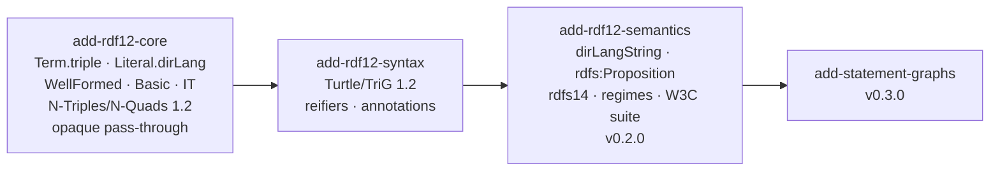
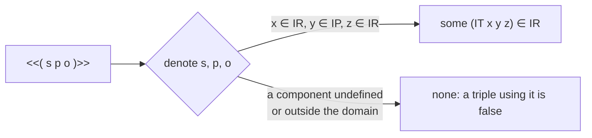
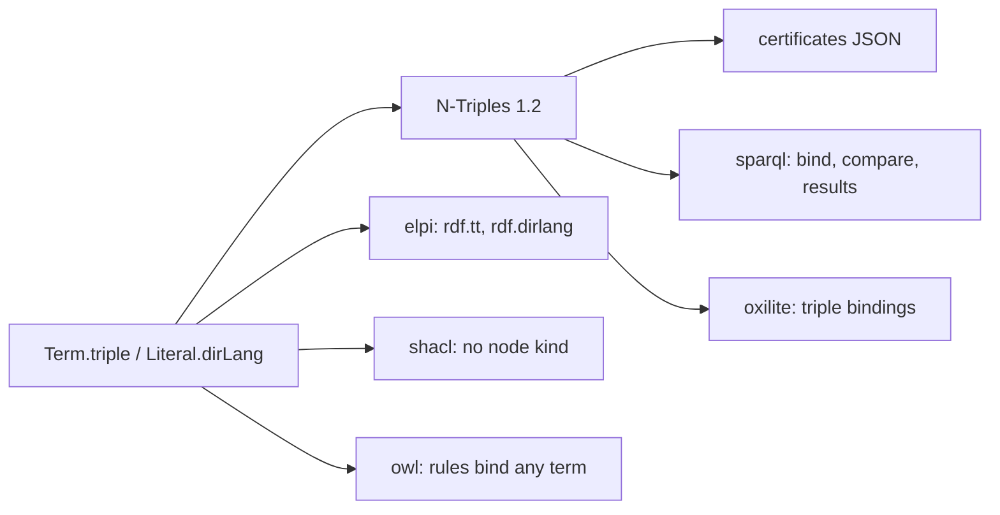
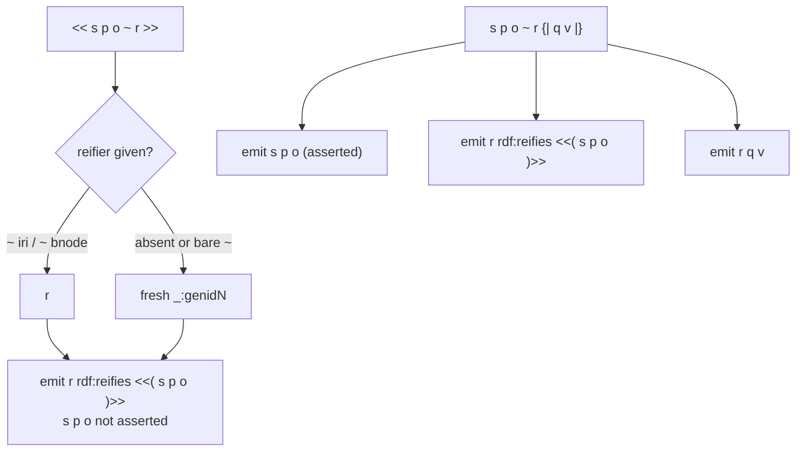
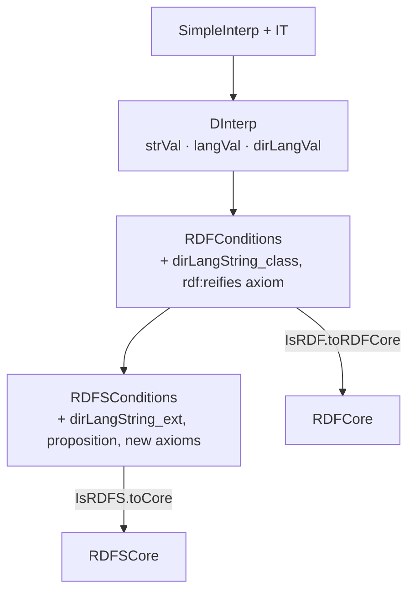
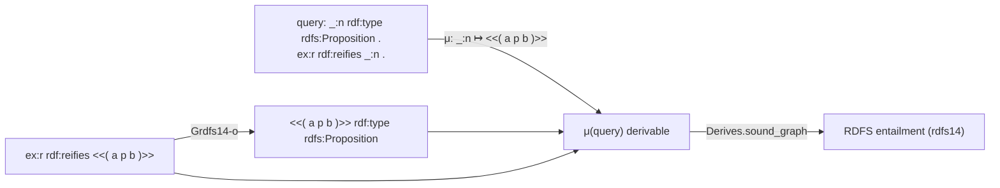
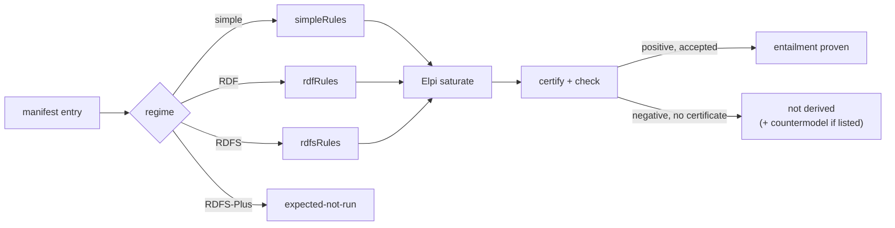

# RDF 1.2

Proposed decisions for RDF 1.2 in LeanRDF, from the design interview of 2026-10-31. They land in three changes. Each moves into [[decisions]] as accepted when its change is archived.

The changes are [[changes#add-rdf12-core]], [[changes#add-rdf12-syntax]] and [[changes#add-rdf12-semantics]] (v0.2.0). They prepare [[changes#add-statement-graphs]]. The vocabulary is in [[concepts]]; the W3C rules are in [[constraints]].

## Triple terms are a recursive Term constructor

`Term` gains `triple (s p o : Term)`, a direct recursive constructor rather than one holding a `Triple`, so `Term` and `Triple` are not mutually inductive and `deriving` keeps working.

**Context.** RDF 1.2 Concepts makes a triple usable as a term. About 34 files in five packages match on `Term` exhaustively.

**Decision.** `inductive Term | iri | bnode | lit | triple (s p o : Term)` with `DecidableEq`, `Hashable`, `Ord` and `Repr` derived. `Triple.toTerm` and `Term.asTriple?` convert. Rejected:
- `triple (t : Triple)`, which brings mutual induction and hand-written instances;
- a separate `Term12`, which means two models, with every proof needed twice;
- a generic `Term α`, which changes every signature.

**Consequences.** Every exhaustive match gains a case in one change. Blank-node renaming and isomorphism recurse into triple terms.

- motivated_by:: [[constraints#RDF 1.2 triples and triple terms]] {weight: primary}
- supersedes:: [[decisions#Generalized triples inside]] {reason: "Triple stays generalized, WellFormed becomes recursive"}
- introduced_by:: [[changes#add-rdf12-core]]

## Strict well-formedness is recursive; Triple stays generalized

`Triple` still allows any term anywhere. `Triple.WellFormed` is the strict RDF 1.2 condition, recursive on the object, and `Basic` separately says "no triple term anywhere".

**Context.** RDF 1.2 allows a triple term only as an object, and its subject must be an IRI or a blank node. Closure under rdfs14 needs triple terms in subject position.

**Decision.** In a well-formed triple, the subject is an IRI or a blank node and the predicate is an IRI. The object is an IRI, a blank node, a literal, or `.triple s p o` with `⟨s, p, o⟩` well formed. Decidable `Term.Basic`, `Triple.Basic`, `Graph.Basic` and `Dataset.Basic` say "no triple term". Parsers build only well-formed triples.

**Consequences.** A well-formed Basic triple is an RDF 1.1 triple, apart from directional literals. One model serves both RDF 1.2 Basic and RDF 1.2 Full conformance.

- motivated_by:: [[constraints#Entailment rules use generalized RDF]] {weight: primary}
- motivated_by:: [[constraints#RDF 1.2 conformance levels]]
- introduced_by:: [[changes#add-rdf12-core]]

## Directional literals are a third Literal constructor

`Literal` gains `dirLang lex tag (dir : Direction)` with `Direction := ltr | rtl`, so each constructor has exactly one datatype: the given IRI, `rdf:langString` or `rdf:dirLangString`.

**Context.** RDF 1.2 adds a base direction to language-tagged strings, with the datatype `rdf:dirLangString`. Tags compare case-insensitively.

**Decision.** `Literal.mk?` rejects `typed _ rdf:dirLangString` as it rejects `typed _ rdf:langString`. Smart constructors lowercase tags. Value-level code reads the tag of `dirLang` like that of `lang`. Rejected:
- an `Option Direction` on `lang`, which changes the arity of every pattern;
- rejecting `--ltr`, which the W3C suites use.

**Consequences.** No well-formedness hypothesis travels with literals. `"a"@EN--ltr` and `"a"@en--ltr` are one term.

- motivated_by:: [[constraints#Directional language-tagged strings]] {weight: primary}
- supersedes:: [[decisions#Literals are typed or language-tagged]]
- introduced_by:: [[changes#add-rdf12-core]]

## IT is part of SimpleInterp from the first change

Simple interpretations gain an injective `IT` on `IR × IP × IR` into `IR`. A triple term denotes `IT` of its components only when they denote inside that domain, and has no referent otherwise.

**Context.** `denote` must be total over the new `Term`. Leaving triple terms without a referent would make every graph that holds one unsatisfiable, so it would entail everything.

**Decision.** `IT : Dom → Dom → Dom → Dom`, with injectivity and `IT_IR` on the domain. `denote` returns `some (IT x y z)` when the components denote `x`, `y`, `z` with `IR x ∧ IP y ∧ IR z`, decided classically, and `none` otherwise. `IL` on `dirLang` literals stays unconstrained until [[changes#add-rdf12-semantics]].

**Consequences.** Existing soundness theorems keep their statements. `denote` is noncomputable, which [[decisions#Axiom-clean library]] allows. rdfs14 can be proven sound later, because every denoted triple term lies in the image of `IT` on its domain.

- motivated_by:: [[constraints#Triple-term denotation]] {weight: primary}
- amends:: [[decisions#Single-carrier interpretations]] {note: "adds IT on the single carrier"}
- introduced_by:: [[changes#add-rdf12-core]]

## Small models become free triple-term extensions

The vacuity models' carriers become `Free D := base d | tt x y z`, with `IT = tt`, because an injective `IT` has no finite model once `IR` has two elements.

**Context.** Every countermodel in `Tests/Semantics/` is built over a finite carrier.

**Decision.** `IR` is the old `IR` on `base` plus every `tt` whose components qualify. `IEXT` is the old relation on `base` and empty on `tt`. Injectivity of `IT` is constructor injectivity.

**Consequences.** Every existing countermodel survives unchanged. The same family gives the countermodel for "a triple term is not asserted".

- motivated_by:: [[constraints#Triple-term denotation]] {weight: primary}
- amends:: [[decisions#Small-model family for vacuity]] {note: "carriers become Free D"}
- introduced_by:: [[changes#add-rdf12-core]]

## N-Triples and N-Quads 1.2 move with the core

The N-Triples and N-Quads parsers and the canonical serializer move to RDF 1.2 in the core change, because certificates, bridges and fixtures all exchange terms in N-Triples.

**Context.** [[decisions#Canonical N-Triples output]] makes N-Triples the shared term syntax. Opaque pass-through needs it to carry triple terms.

**Decision.**
- The parser gains `tripleTerm` objects and `LANG_DIR`, where a direction other than `ltr`/`rtl` is an error.
- It also gains a case-sensitive `VERSION` directive, recorded and ignored.
- The serializer writes canonical 1.2: lowercase `LANG_DIR`, single spaces inside `<<( … )>>`, no `VERSION`.

**Consequences.** A Basic graph without directional literals serializes byte-identically to RDF 1.1, so the old round-trip tests run unchanged. The W3C RDF 1.2 `rdf-n-triples` (with `c14n`) and `rdf-n-quads` suites run.

- motivated_by:: [[constraints#RDF 1.2 N-Triples grammar]] {weight: primary}
- motivated_by:: [[constraints#RDF 1.2 N-Quads grammar]]
- amends:: [[decisions#Canonical N-Triples output]] {note: "canonical 1.2 forms"}
- amends:: [[decisions#Recursive-descent N-Triples parser]] {note: "tripleTerm, LANG_DIR, VERSION"}
- introduced_by:: [[changes#add-rdf12-core]]

## Opaque pass-through downstream

Every downstream package accepts triple terms and directional literals with the least behaviour their specs define, and adds no RDF 1.2 features.

**Context.** The interview deferred SPARQL 1.2 and wanted nothing to break on RDF 1.2 input.

**Decision.**
- Elpi encodes `rdf.tt` and `rdf.dirlang`, and certificates use N-Triples 1.2.
- SPARQL binds triple terms and compares them by equality. `isIRI`, `isBlank` and `isLiteral` are false on them. Results use the RDF 1.2 result forms.
- SHACL gives them no node kind.
- OWL rules bind them like any term.
- The oxilite bridge reads `triple` bindings.

Rejected: rejecting non-Basic input at package boundaries, and a full SPARQL 1.2 upgrade now.

**Consequences.** Downstream proofs gain a case and keep their statements. RDF 1.2 features above the data model come in later changes.

- motivated_by:: [[constraints#RDF 1.2 conformance levels]] {weight: primary}
- amends:: [[decisions#Hand-written Elpi term encoding]] {note: "rdf.tt and rdf.dirlang"}
- introduced_by:: [[changes#add-rdf12-core]]

## Reification as sugar in the statement parser

Reified triples and annotations are expanded while parsing, into `rdf:reifies` triples in the current graph. No reified-triple node exists in any data structure.

**Context.** RDF 1.2 Turtle §7.3 is written as one-pass rules over `curReifier`. The Turtle parser already emits triples as it reads, and TriG shares it.

**Decision.**
- `reifiedTriple` is an alternative of `object` and of the subject of `triples`. It emits `r rdf:reifies <<( s p o )>>` with `r` the given reifier or a fresh blank node, and returns `r`.
- `objectList` parses an annotation after each object: one reifying triple per reifier, and a fresh reifier for a block without one.
- Only annotated triples are asserted.

**Consequences.** Nesting needs no extra code, and TriG gets reification for free. Statement graphs read reifiers from plain graphs.

- motivated_by:: [[constraints#Turtle 1.2 reification mapping]] {weight: primary}
- motivated_by:: [[decisions#TriG on the Turtle statement parser]] {weight: secondary}
- introduced_by:: [[changes#add-rdf12-syntax]]

## Triple terms parsed by restricted productions

`tripleTerm` is its own production with `ttSubject` and `ttObject`, not a call to `object`, so collections, property lists and reified triples inside a triple term are syntax errors by construction.

**Context.** The grammar restricts triple-term components more than ordinary objects. `object` emits triples for collections, which would then have to be withdrawn.

**Decision.** `<<(` is one token, matched before `<<` and `<`. Every triple term the parser builds is strictly well formed. Rejected: parsing with `object` and checking afterwards, which gives worse error positions.

**Consequences.** Negative syntax tests fail at the right column, and no well-formedness check runs after parsing.

- motivated_by:: [[constraints#Turtle 1.2 grammar]] {weight: primary}
- introduced_by:: [[changes#add-rdf12-syntax]]

## Version announcements are hints

`@version "…" .` and `VERSION "…"` are parsed and their label discarded. A `1.2-basic` document with triple terms still parses.

**Context.** RDF 1.2 Turtle §2.4 calls the version label a hint. The core change chose one RDF 1.2 model with a `Basic` predicate, not parser modes.

**Decision.** No mode switch, and no rejection of unknown labels. If a W3C negative test requires otherwise, the test wins and this decision is amended.

**Consequences.** One parser for every document. Basic conformance is a property of the result, decided by `Graph.Basic`.

- motivated_by:: [[constraints#Turtle 1.2 grammar]] {weight: primary}
- motivated_by:: [[constraints#RDF 1.2 conformance levels]]
- introduced_by:: [[changes#add-rdf12-syntax]]

## Generated reifiers share the genid scheme

Fresh reifiers come from the existing fresh-node generator and are renamed with every other generated node. The label scan and the renaming recurse into triple terms.

**Context.** The Turtle parser already generates NUL-prefixed blank nodes and renames them to `genidN`, avoiding document labels.

**Decision.** There is no second counter or prefix. A `_:genid1` inside `<<( … )>>` counts as a document label and is avoided.

**Consequences.** There is one collision-free scheme. Evaluation tests compare up to isomorphism, which now maps blank nodes inside triple terms.

- motivated_by:: [[decisions#TriG on the Turtle statement parser]] {weight: secondary}
- introduced_by:: [[changes#add-rdf12-syntax]]

## RDF 1.2 suites beside the RDF 1.1 suites

The W3C RDF 1.2 Turtle and TriG suites are vendored at one pinned commit next to the RDF 1.1 copies, without following their `mf:include` of the 1.1 tree.

**Context.** The RDF 1.2 manifests include the RDF 1.1 suites, and the existing 1.1 requirements cite their own paths and counts.

**Decision.** `Tests/data/rdf12-turtle/` and `Tests/data/rdf12-trig/` hold the `syntax` and `eval` sub-manifests. `scripts/w3c-index.py` learns sub-manifests.

**Consequences.** The 1.1 suites and their requirements stay untouched, and the 1.2 suites add their own counts.

- motivated_by:: [[constraints#Turtle 1.2 grammar]]
- motivated_by:: [[constraints#TriG 1.2 grammar]]
- introduced_by:: [[changes#add-rdf12-syntax]]

## Three recognized datatypes with abstract values

D-interpretations recognize `rdf:dirLangString` through an injective abstract field `dirLangVal`, beside `strVal` and `langVal`.

**Context.** RDF 1.2 Semantics §8 says `rdf:dirLangString` MUST be recognized. A directional literal denotes the triple of its lexical form, lowercased tag and base direction.

**Decision.** `IL_dirLang : IL (.dirLang s t d) = some (dirLangVal s t.toLower d)`. The RDF and RDFS conditions gain one field each for the new class. `datatypes` and `datatypeAxioms` include it. Rejected: reusing `langVal` with an optional direction, which would blur two value spaces.

**Consequences.** D grows to three datatypes, and the simplification on abstract values is renamed to match.

- motivated_by:: [[constraints#RDF 1.2 RDF interpretations]] {weight: primary}
- amends:: [[decisions#Layered interpretations with a core]]
- introduced_by:: [[changes#add-rdf12-semantics]]

## Propositions are the image of IT on its domain

The RDFS proposition condition is transcribed one way, as its table row states it: every `IT x y z` with `IR x`, `IP y`, `IR z` is in `ICEXT(I(rdfs:Proposition))`.

**Context.** §9's prose calls the class "exactly the set of propositions", but its condition is one-way. Quantifying over all of `IT`'s image would narrow the class of interpretations.

**Decision.** `RDFSConditions.proposition` and `RDFSCore.proposition` over the domain. Rule soundness relies on `denote` giving triple terms referents only on that domain ([[rdf12#IT is part of SimpleInterp from the first change]]).

**Consequences.** Every denoted triple term is a proposition in every RDFS interpretation. That is exactly what rdfs14 needs, without strengthening the entailment relation beyond the spec's.

- motivated_by:: [[constraints#RDF 1.2 RDFS conditions]] {weight: primary}
- motivated_by:: [[constraints#Triple-term denotation]] {weight: primary}
- amends:: [[decisions#Readings of the condition tables]]
- introduced_by:: [[changes#add-rdf12-semantics]]

## Triple-term patterns in rules

`Pat` gains `triple (s p o : Pat)`, so a rule can match inside a triple term and build one in its head. The checker's matching lemma and the Elpi clause generator follow.

**Context.** rdfs14 types triple terms, including nested ones. A guard can test that a value is a triple term but cannot name its components.

**Decision.** `matchPat` matches only `Term.triple` against `Pat.triple` and recurses into it. `match p t = some σ → σ.apply p = t` extends by induction. Codegen writes Elpi triple-term terms with variables. Rejected: a `tripleTerm` guard, and a special rule kind for rdfs14.

**Consequences.** One format and one checker path. The format stays Horn and range-restricted.

- motivated_by:: [[constraints#Entailment rules use generalized RDF]] {weight: primary}
- amends:: [[decisions#Horn rules matched by the checker]]
- amends:: [[decisions#Rules generated from Lean]]
- introduced_by:: [[changes#add-rdf12-semantics]]

## rdfs14 as generalized Horn rules plus graph queries

rdfs14 and rdfs14a become generalized rules that type a triple term itself as `rdfs:Proposition`. The spec's blank-node forms follow as graph queries with an instance mapping, as rdfD1 follows from GrdfD1.

**Context.** rdfs14 replaces a triple term by a fresh blank node, and the rule format has no existential heads.

**Decision.**
- `Grdfs14-s`, `Grdfs14-p` and `Grdfs14-o` type a top-level triple term.
- `Grdfs14-in-s`, `Grdfs14-in-p` and `Grdfs14-in-o` type a triple term inside a proposition.
- `rdfs14a` is the ground `<<( rdf:type rdf:type rdf:Property )>> rdf:type rdfs:Proposition`.

Rejected: existential heads, and leaving rdfs14 out.

**Consequences.** Heads reuse body subterms, so saturation stays finite. The W3C tests on propositions are certified.

- motivated_by:: [[constraints#RDF 1.2 entailment patterns]] {weight: primary}
- motivated_by:: [[constraints#Entailed blank nodes are existential]]
- amends:: [[decisions#Graph queries with instance mappings]]
- introduced_by:: [[changes#add-rdf12-semantics]]

## Regime rule sets for simple and RDF entailment

`simpleRules` (no rules) and `rdfRules` (rdfD2, GrdfD1 for D, the RDF axioms) get their own soundness theorems, so positive tests of those regimes are proven at their own strength.

**Context.** Certifying a simple or RDF positive test with `rdfsRules` proves only RDFS entailment, which is weaker than the test's claim.

**Decision.** `Derives.sound_graph_simple` from the interpolation lemma. `Derives.sound_graph_rdf` from a new `RDFCore` derived from `IsRDF`. Checker corollaries `checkQuery_sound_simple` and `checkQuery_sound_rdf`.

**Consequences.** The certificate format is unchanged; only the rule list chosen per regime differs.

- motivated_by:: [[constraints#RDF 1.2 semantics test suite]] {weight: primary}
- amends:: [[decisions#Layered interpretations with a core]]
- introduced_by:: [[changes#add-rdf12-semantics]]

## The W3C semantics suite in the bridge package

The W3C RDF 1.2 `rdf-semantics` suite runs in `leanrdf-elpi`: a positive test passes on an accepted certificate under its regime, and a negative test passes as "not derived".

**Context.** No semantics suite runs today. Saturation needs Elpi, and completeness is not proven.

**Decision.**
- For each test, the runner parses with Turtle 1.2, picks the rule list by `mf:entailmentRegime`, saturates, certifies the result graph as a query and checks the certificate.
- Negative tests about triple terms also get kernel countermodels.
- An expected-not-run file lists `RDFS-Plus` tests and tests that need datatypes outside D, each with its reason.

**Consequences.** Every reported pass is as strong as what is proven. "Not derived" is never reported as "not entailed".

- motivated_by:: [[constraints#RDF 1.2 semantics test suite]] {weight: primary}
- motivated_by:: [[decisions#Elpi finds, Lean checks]]
- motivated_by:: [[decisions#Demo never claims non-entailment]]
- introduced_by:: [[changes#add-rdf12-semantics]]

## Vacuity with propositions

The small-model family makes `rdfs:Proposition` a universal class and gives `rdf:dirLangString` an exact extension. It adds a model with a reifier, the non-assertion countermodel and hand proofs of rdfs14.

**Context.** New conditions could make the RDFS semantics unsatisfiable, so that every entailment would hold vacuously.

**Decision.** Kernel proofs in `Tests/Semantics/`, without `native_decide`, over the free triple-term extension.

**Consequences.** The RDF 1.2 conditions are shown satisfiable and non-trivial before v0.2.0 ships.

- amends:: [[decisions#Small-model family for vacuity]]
- amends:: [[decisions#Semantics tested against vacuity]]
- introduced_by:: [[changes#add-rdf12-semantics]]
