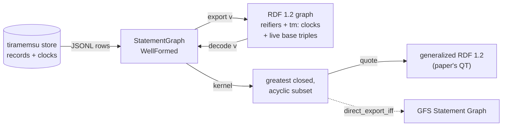
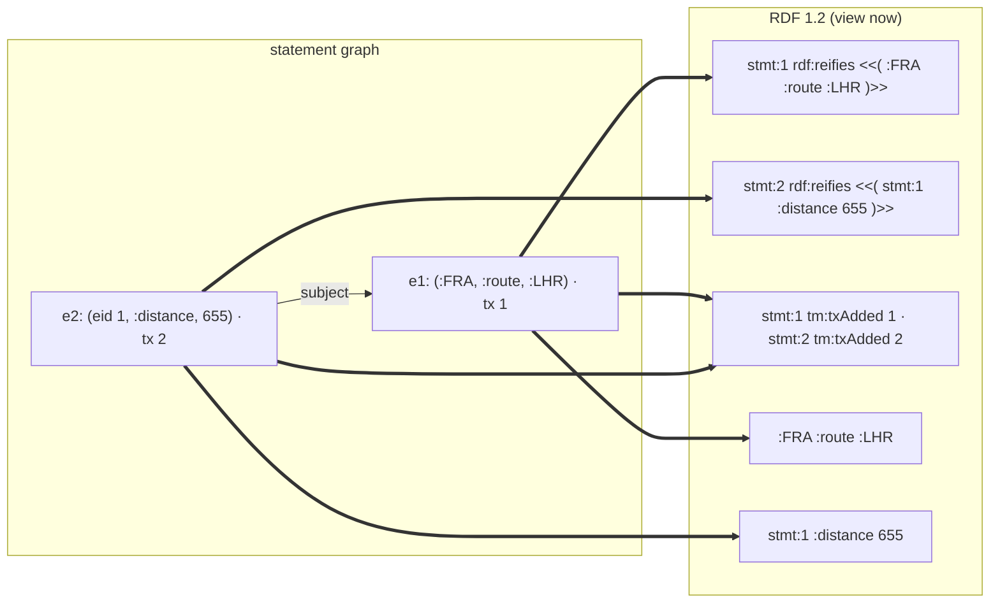
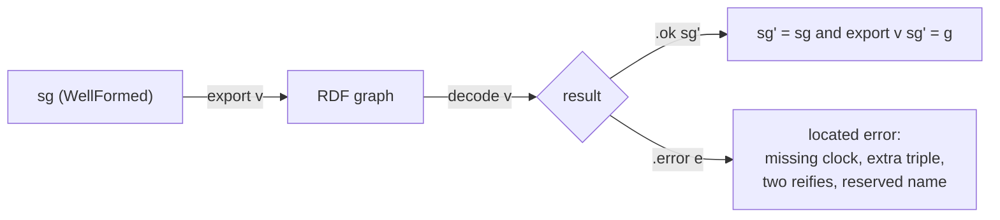

# Statement graphs

Proposed decisions for statement graphs in LeanRDF, from the design interview of 2026-10-31, landing in [[changes#add-statement-graphs]] (v0.3.0). They move into [[decisions]] when the change is archived.

The model is tiramemsu's bitemporal record store, read as a Gelling–Fletcher–Schmidt Statement Graph and exported to RDF 1.2 ([[decisions]]). The terms are defined in [[concepts]]. The proofs build on the paper *When Is a Temporal Statement Store a Statement Graph?* (Zenodo 10.5281/zenodo.23335652).

## Bitemporal records with eid references

A statement graph is a finite map from eids to records `(eid, s, p, o, txAdded, txRetracted?, validFrom?, validTo?)`. The subject and object are a term or another record's eid.

**Context.** tiramemsu stores exactly these rows, and the paper's history theorems need the transaction order. The interview chose bitemporal records over an atemporal model.

**Decision.** `Node := term (t : Term) | eid (e : Nat)` matches the paper's `Node T E`. Transaction time is `Nat`, since only its order matters. Valid time is `Int` epoch milliseconds, as tiramemsu stores it. Other metadata, such as provenance or confidence, is ordinary records about an eid. Rejected: an atemporal model, and a generic `meta : M` parameter.

**Consequences.** The vendored theorems instantiate by substitution. The `tm:` export and the history theorems live in LeanRDF.

- motivated_by:: [[constraints#tiramemsu record model]] {weight: primary}
- introduced_by:: [[changes#add-statement-graphs]]

## Assertion is derived from a view

A record has no stored `asserted` flag. It is live in a view (`now`, `asOf t` or `history`, with an optional valid-time point), and the export asserts exactly the live records.

**Context.** The interview first chose a per-statement flag. With two clocks, a stored flag could disagree with them, and tiramemsu has no such state.

**Decision.**
- `now`: not retracted.
- `asOf t`: `txAdded ≤ t` and not `txRetracted ≤ t`.
- `history`: always live.
- A valid-time point is checked against `[validFrom, validTo)`.

**Consequences.** One statement graph has one export per view, and all of them decode to the same records.

- motivated_by:: [[constraints#tiramemsu record model]] {weight: primary}
- introduced_by:: [[changes#add-statement-graphs]]

## Reifier export is primary

Each record exports as `stmt:e rdf:reifies <<( s' p o' )>>`, its `tm:` clock triples, and its base triple when live, with eid references replaced by `stmt:` IRIs. That is strict RDF 1.2, with no closure or acyclicity needed.

**Context.** Strict RDF 1.2 forbids triple terms in subject position, including inside a triple term. The paper's quoting map nests a referenced statement there.

**Decision.** References are names, so dangling references and cycles export as plain IRIs. Two records with equal content give two reifiers of one triple term. In Turtle 1.2 a reference reads `<< << :FRA :route :LHR ~ stmt:1 >> :distance 655 ~ stmt:2 >>`. Rejected: quoting as the primary export, and reifiers without a quoting view.

**Consequences.** Every well-formed statement graph exports, including snapshots and replays. The paper's theorems stay reachable through the quoting view.

- motivated_by:: [[constraints#RDF 1.2 triples and triple terms]] {weight: primary}
- motivated_by:: [[constraints#Statement Graph definition]]
- introduced_by:: [[changes#add-statement-graphs]]

## Exact decoder and the reserved names

`decode v` accepts exactly the exports of well-formed statement graphs under `v`, and both round-trip directions are theorems. `WellFormed` keeps the export's own names out of user content.

**Context.** Without reserved names, a user IRI `urn:tiramemsu:stmt:5` would read as eid 5, and a record `(eid 1, tm:txAdded, 7)` would collide with eid 1's clock.

**Decision.**
- `WellFormed` forbids `stmt:` IRIs anywhere in content, inside triple terms included.
- It forbids `rdf:reifies` and the four time predicates as record predicates, and self-reference.
- It enforces strict RDF 1.2 positions.
- The theorems are `decode v (export v sg) = .ok sg` and `decode v g = .ok sg → export v sg = g`.

Rejected: time triples in a named graph, escaping clashing IRIs, and a lenient decoder.

**Consequences.** The certify bridge for tiramemsu can check an export by decoding it. Arbitrary RDF 1.2 import is a separate, later function.

- motivated_by:: [[constraints#tiramemsu record model]] {weight: primary}
- introduced_by:: [[changes#add-statement-graphs]]

## Admit tiramemsu's sets

The statement-graph type admits dangling references and reference cycles, and forbids only self-reference. Closed and acyclic are preconditions only of the Statement Graph and quoting theorems.

**Context.** tiramemsu snapshots can dangle, and correction replays can cycle. A subtype of closed, acyclic graphs could not represent them.

**Decision.** One type covers every tiramemsu state. `isClosed`, `isAcyclic` and `kernel` explain what a state lacks. Rejected: closed and acyclic by type, and closed with cycles allowed.

**Consequences.** The reifier export and the decoder are total. `leanrdf-sg check` reports dangling references and cycles as warnings, not errors.

- motivated_by:: [[constraints#tiramemsu record model]] {weight: primary}
- motivated_by:: [[constraints#Statement Graph definition]]
- introduced_by:: [[changes#add-statement-graphs]]

## Vendored abstract proofs, concrete layer on top

The paper's abstract Lean (Kernel, Export, History, Quoting; about 1.4k lines, core only) is vendored into `statements/` with its DOI and source commit. It is ported to Lean 4.35 and instantiated with `T := Term`, `E := Nat`, `L := Term`.

**Context.** The paper proves `direct_export_iff`, `K_greatest`, `history_closed` and `bgp_view` over abstract types on Lean 4.34.1.

**Decision.** `Abstract/` keeps the paper's names and statements. The concrete layer maps `QT Term` into `Term.triple`, and groups a history's batches by `txAdded`. Rejected: a Lake git dependency on the tiramemsu subdirectory, re-proving concretely, and a shared third repository.

**Consequences.** Neither build depends on the other repository. Drift is visible through the recorded commit.

- motivated_by:: [[constraints#Statement Graph definition]] {weight: primary}
- motivated_by:: [[constraints#Lean toolchain 4.35]]
- introduced_by:: [[changes#add-statement-graphs]]

## Executable kernel proven against K

`kernel` is a Kahn-style peel with `mem_kernel_iff : e ∈ kernel sg ↔ K e`. `isClosed` and `isAcyclic` are decided by the same machinery and proven equal to the paper's `Closed` and `Acyclic`.

**Context.** The paper computes the export kernel in linear time but defines it as a relation.

**Decision.** Keep an in-degree count of unresolved references, and resolve until a fixpoint. Dropped records are reported as dangling or cyclic. The linear-time bound is not mechanized.

**Consequences.** `leanrdf-sg kernel` and the quoting view run on proven code. A brute-force agreement test covers small graphs.

- motivated_by:: [[constraints#Statement Graph definition]]
- introduced_by:: [[changes#add-statement-graphs]]

## A separate package with a CLI

Statement graphs live in `statements/` (`leanrdf-statements`), requiring only the core. It provides the library, tests and `leanrdf-sg check|export|decode|kernel|quote` over JSON-lines records.

**Context.** The package carries tiramemsu's `tm:` and `stmt:` IRIs, views and bitemporal records, which do not belong in the dependency-free core.

**Decision.** The core gains only general pieces: epoch milliseconds to `xsd:dateTime` and back, with round-trip theorems. The `tm:` IRIs never enter `LeanRDF.Vocab`. Records are read as JSON lines whose terms use N-Triples 1.2 syntax.

**Consequences.** Users of the core never build statement graphs. v0.3.0 adds the package to CI and the release.

- motivated_by:: [[decisions#Layers as packages in one repository]] {weight: primary}
- motivated_by:: [[decisions#Dependency-free core package]]
- introduced_by:: [[changes#add-statement-graphs]]

## LeanRDF's export is the reference format

LeanRDF's `export` defines the RDF 1.2 form of a tiramemsu store. tiramemsu later adds a matching `tm export`, and until then the goldens are hand-written and tagged `pending tm cross-check`.

**Context.** `tm export` writes only live, flat statements today: no reifiers, no `stmt:` names and no clocks.

**Decision.** The spec in `openspec/specs/statement-graphs` is the contract. A script later regenerates the goldens from `tm` and diffs them.

**Consequences.** No blocking dependency on the Rust side. LeanRDF plays the same role towards tiramemsu as towards oxilite.

- motivated_by:: [[decisions#LeanRDF is the proof layer for oxilite]] {note: "same role towards tiramemsu"}
- introduced_by:: [[changes#add-statement-graphs]]
